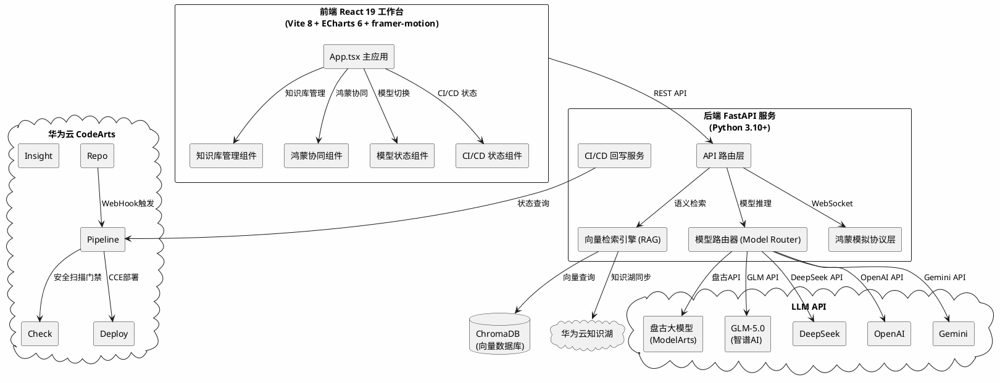

# OPC 转化医学 Agent 系统 — 五大技术要求改进实现方案

> **文档版本**: v1.0  
> **生成日期**: 2026-06-25  
> **文档类型**: 技术设计文档  
> **基于需求**: `.agents/requirements.md` v1.0（27条EARS格式需求）  
> **技术栈**: React 19 + Vite 8 + FastAPI + ChromaDB + WebSocket  

---

# 1. 实现模型

## 1.1 上下文视图



## 1.2 服务/组件总体架构

### 1.2.1 改进后目标架构

系统从当前的**单体双文件架构**（App.tsx + main.py）演进为**模块化分层架构**，按5大技术方向解耦：

| 层次 | 职责 | 新增模块 |
|------|------|---------|
| **前端展示层** | UI组件渲染与交互 | `src/components/` 拆分出的独立组件 |
| **前端状态层** | 全局状态管理 | `src/stores/` 集中管理各模块状态 |
| **后端API层** | 请求路由与参数校验 | `backend/routers/` 按领域拆分路由 |
| **后端服务层** | 核心业务逻辑 | `backend/services/` 按技术方向拆分服务 |
| **后端协议层** | 外部系统适配 | `backend/adapters/` 协议适配器 |
| **基础设施层** | 向量库/WS/CI/CD | `backend/infra/` 基础设施抽象 |

### 1.2.2 改进前后目录结构对比

**改进前**：
```
src/
  App.tsx          (2750行，含所有组件与状态)
  App.css
backend/
  main.py          (1110行，含所有API与业务逻辑)
```

**改进后**：
```
src/
  App.tsx                          (精简至~500行，组合各子组件)
  App.css
  components/
    KnowledgeManager.tsx           (知识库管理界面)
    RAGReferencePanel.tsx          (RAG参考凭据展示，含相似度评分)
    HarmonyDrawer.tsx              (鸿蒙端云协同抽屉)
    NpuSandboxPanel.tsx            (NPU脱敏沙箱，升级真实脱敏)
    ModelSelector.tsx              (模型选择器，含真实模型名称展示)
    ModelBenchmarkPanel.tsx        (模型性能基准对比)
    CICDStatusPanel.tsx            (CI/CD流水线状态展示)
    PipelineStatusWidget.tsx       (流水线状态小组件)
  hooks/
    useWebSocket.ts                (WebSocket连接管理)
    useModelRouter.ts              (模型路由与降级)
    useVectorSearch.ts             (向量检索钩子)
  lib/
    npuSanitizer.ts                (NPU真实脱敏逻辑)
    wsNearLinkSim.ts               (星闪WebSocket模拟层)
    modelConfig.ts                 (模型供应商配置)
  stores/
    modelStore.ts                  (模型状态管理)
    knowledgeStore.ts              (知识库状态管理)
    harmonyStore.ts                (鸿蒙协同状态管理)
backend/
  main.py                          (精简至~200行，FastAPI启动与路由注册)
  routers/
    analyze.py                     (论文分析路由)
    chat.py                        (对话Agent路由)
    knowledge.py                   (知识库管理路由)
    harmony.py                     (鸿蒙协同路由)
    cicd.py                        (CI/CD状态路由)
    models.py                      (模型管理路由)
  services/
    rag_service.py                 (向量检索服务)
    model_router_service.py        (模型路由与降级服务)
    npu_sanitizer_service.py       (NPU脱敏服务)
    knowledge_service.py           (知识库CRUD服务)
    harmony_ws_service.py          (鸿蒙WebSocket服务)
    cicd_service.py                (CI/CD回写服务)
    devlog_service.py              (DevLog自动记录服务)
  adapters/
    pangu_adapter.py               (盘古大模型适配器)
    glm_adapter.py                 (GLM-5.0适配器)
    deepseek_adapter.py            (DeepSeek适配器)
    openai_adapter.py              (OpenAI适配器)
    gemini_adapter.py              (Gemini适配器)
    base_llm_adapter.py            (模型适配器基类)
    knowledge_lake_adapter.py      (华为云知识湖适配器)
    codearts_pipeline_adapter.py   (CodeArts Pipeline适配器)
  infra/
    chroma_client.py               (ChromaDB客户端封装)
    ws_server.py                   (WebSocket服务器)
  models/
    schemas.py                     (Pydantic数据模型)
    knowledge_entry.py             (知识库条目模型)
    model_provider.py              (模型供应商配置模型)
    harmony_device.py              (鸿蒙设备状态模型)
    pipeline_status.py             (流水线状态模型)
```

### 1.2.3 新增配置文件

```
项目根目录/
  .claude/
    pipeline.yaml                  (CodeArts Pipeline配置)
    checkrule.yaml                 (CodeArts Check规则配置)
  backend/
    requirements.txt               (新增依赖声明)
  docker/
    Dockerfile.frontend            (前端Nginx容器)
    Dockerfile.backend             (后端Python容器)
    docker-compose.yml             (本地开发编排)
```

## 1.3 实现设计文档

### 1.3.1 技术方向5.1：华为云码道平台特色能力联动

#### 1.3.1.1 CI/CD流水线自动触发（REQ-5.1-01）

**实现方案**：通过CodeArts Pipeline YAML配置实现代码推送自动触发构建流程。

**Pipeline配置** (`pipeline.yaml`)：

```yaml
# CodeArts Pipeline 配置
version: '1.0'
name: opc-translational-medicine-pipeline
triggers:
  - type: push
    branches: [main, master]
stages:
  - name: 前端构建
    steps:
      - name: npm-install-build
        image: node:20-alpine
        commands:
          - cd src && npm ci && npm run build
        artifacts:
          - name: frontend-dist
            path: src/dist/
  - name: 后端测试
    steps:
      - name: pytest
        image: python:3.10-slim
        commands:
          - cd backend && pip install -r requirements.txt && pytest tests/ -v
  - name: 安全检查门禁
    steps:
      - name: codearts-check
        type: codearts-check
        config:
          rules: [sql-injection, xss, sensitive-data, hardcoded-key]
          fail_on_high: true  # 高危漏洞阻止合并
  - name: 部署预览
    steps:
      - name: deploy-preview
        type: codearts-deploy
        config:
          target: cce
          namespace: opc-preview
```

**DevLog自动记录**（REQ-5.1-03）：Pipeline完成后，通过WebHook回调后端 `/api/cicd/webhook` 端点，后端脚本化地将流水线状态追加至 `CodeArts_Agent_DevLog.md`。

**关键设计决策**：
- Pipeline YAML作为代码仓库的一部分版本化管理
- 安全检查门禁设为P0级别，高危漏洞阻断部署
- DevLog回写通过Pipeline WebHook触发，无需人工干预

#### 1.3.1.2 安全风险自动识别阻止合并（REQ-5.1-02）

**实现方案**：接入CodeArts Check代码检查服务，配置分支保护规则。

**配置要点**：
- 在CodeArts平台项目设置中启用"代码检查"服务
- 配置检查规则集：SQL注入检测、XSS检测、敏感信息泄露、硬编码密钥检测
- 分支保护规则：main/master分支的PR必须通过Check扫描方可合并
- 降级机制：Check服务不可用时，允许合并但标记为"未检查"状态（需在PR页面显示警告）

#### 1.3.1.3 DevLog自动记录流水线状态（REQ-5.1-03）

**实现方案**：后端新增 `cicd_service.py`，监听Pipeline WebHook，自动追加DevLog条目。

**DevLog条目格式**：
```
## 🔄 CI/CD 流水线执行记录
- **时间**: 2026-06-25T14:30:00+08:00
- **流水线**: opc-translational-medicine-pipeline
- **状态**: ✅ 成功 / ❌ 失败 / ⏱️ 超时
- **构建产物**: [dist.tar.gz](artifact-url)
- **执行耗时**: 127秒
```

**后端端点设计**：

```python
# backend/routers/cicd.py
@router.post("/api/cicd/webhook")
async def pipeline_webhook(payload: PipelineWebhookPayload):
    """接收CodeArts Pipeline WebHook回调，自动记录DevLog"""
    devlog_service.append_pipeline_record(
        pipeline_name=payload.pipeline_name,
        status=payload.status,
        artifact_url=payload.artifact_url,
        duration_seconds=payload.duration_seconds
    )
    return {"status": "ok"}
```

---

### 1.3.2 技术方向5.2：CodeArts生态联动

#### 1.3.2.1 项目初始化至CodeArts Repo托管（REQ-5.2-01）

**前置条件**：当前项目无`.git`仓库，需完成以下步骤：

**实施方案**：
1. 本地执行 `git init` + 添加 `.gitignore`（排除 node_modules, __pycache__, .env, dist, *.pyc）
2. 创建初始提交 `git commit -m "feat: OPC转化医学Agent系统初始版本"`
3. 在华为云CodeArts平台创建项目，获取Repo仓库HTTPS/SSH地址
4. 添加远程仓库并推送 `git remote add origin <CodeArts-Repo-URL> && git push -u origin main`
5. 确保Repo页面可查看完整项目结构与提交历史

**`.gitignore` 配置**：
```
node_modules/
dist/
__pycache__/
*.pyc
.env
*.egg-info/
.venv/
chroma_data/
```

#### 1.3.2.2 CodeArts Repo推送触发Pipeline（REQ-5.2-02）

**实现方案**：在CodeArts Repo项目设置中配置WebHook，代码推送至main分支时自动触发Pipeline。

**触发链路**：
```
git push origin main → CodeArts Repo WebHook → Pipeline自动启动
  → 阶段1: 前端构建(npm run build)
  → 阶段2: 后端测试(pytest)
  → 阶段3: 安全扫描(CodeArts Check)
  → 阶段4: 部署预览(CCE)
```

#### 1.3.2.3 前端实时展示构建状态（REQ-5.2-03）

**实现方案**：后端新增CI/CD状态代理端点，前端轮询展示。

**后端端点**：
```python
# backend/routers/cicd.py
@router.get("/api/cicd/pipeline/status")
async def get_pipeline_status():
    """代理查询CodeArts Pipeline最近一次执行状态"""
    # 调用CodeArts Pipeline API查询状态
    status = await cicd_service.query_latest_pipeline()
    return status
```

**前端组件**：`CICDStatusPanel.tsx`，5秒轮询更新，展示构建状态指示器（排队/运行/成功/失败）与最近10条构建日志。

#### 1.3.2.4 一键部署到华为云CCE（REQ-5.2-05）

**实现方案**：通过CodeArts Deploy服务配置，Pipeline部署阶段自动推送Docker镜像至CCE。

**Docker化配置**：

`docker/Dockerfile.frontend`：
```dockerfile
FROM nginx:alpine
COPY ../src/dist /usr/share/nginx/html
EXPOSE 80
```

`docker/Dockerfile.backend`：
```dockerfile
FROM python:3.10-slim
WORKDIR /app
COPY ../backend/ .
RUN pip install -r requirements.txt
EXPOSE 8000
CMD ["uvicorn", "main:app", "--host", "0.0.0.0", "--port", "8000"]
```

---

### 1.3.3 技术方向5.3：私有知识库与企业规范对齐

#### 1.3.3.1 向量数据库选型：ChromaDB

**选型理由**：
- Python原生支持，与FastAPI无缝集成
- 轻量级嵌入式部署，无需独立服务进程（竞赛环境下快速启动）
- 支持本地持久化存储（`chroma_data/`目录）
- 内置HNSW索引，检索性能满足≤3秒要求
- 社区生态成熟，文档完善

**备选方案**：FAISS（Facebook AI Similarity Search），性能更优但无内置持久化，需额外封装。

**最终决策**：**ChromaDB** 作为主选，满足竞赛场景下的快速集成与本地持久化需求。

#### 1.3.3.2 Embedding方案：bge-large-zh-v1.5

**选型理由**：
- 国产开源模型，中文语义理解能力强（转化医学领域文献以中文为主）
- 768维向量，平衡精度与存储
- 支持本地推理（通过`sentence-transformers`库），无需额外API调用
- HuggingFace模型仓库直接下载，离线可用

**备选方案**：
- 调用华为云ModelArts Embedding API：需联网，有调用成本
- OpenAI text-embedding-3-small：需联网+API Key，非国产

**最终决策**：**bge-large-zh-v1.5** 本地推理为主，预留华为云ModelArts Embedding API作为可选远程模式。

**降级机制设计**：

```
向量检索(ChromaDB) → 不可用 → 关键词检索(硬编码FRONTEND_KNOWLEDGE_BASE)
                                      ↓
                               UI标注"⚠️ 降级模式：基础知识库"
```

#### 1.3.3.3 企业文档自动解析分块向量化（REQ-5.3-01）

**实现方案**：

```python
# backend/services/knowledge_service.py
class KnowledgeService:
    async def upload_document(self, file: UploadFile, domain: str) -> dict:
        """上传文档 → 解析 → 分块 → 向量化 → 入库"""
        # 1. 解析文档
        content = await self._parse_document(file)
        # 2. 语义分块（300-500字/块）
        chunks = self._chunk_text(content, chunk_size=400, overlap=50)
        # 3. 向量化
        embeddings = self._embed_texts(chunks)
        # 4. 存入ChromaDB
        self.chroma_client.add_documents(
            collection=domain,
            documents=chunks,
            embeddings=embeddings,
            metadatas=[{"source": file.filename, "domain": domain}] * len(chunks)
        )
        return {"status": "success", "chunks_stored": len(chunks)}
    
    def _parse_document(self, file: UploadFile) -> str:
        """解析PDF/MD/TXT文档"""
        if file.filename.endswith('.pdf'):
            return self._parse_pdf(file)
        elif file.filename.endswith('.md'):
            return file.read().decode('utf-8')
        else:  # .txt
            return file.read().decode('utf-8')
    
    def _chunk_text(self, text: str, chunk_size: int = 400, overlap: int = 50) -> list[str]:
        """按语义边界分块，避免句子截断"""
        sentences = re.split(r'[。！？\n]', text)
        chunks, current_chunk = [], ""
        for sentence in sentences:
            if len(current_chunk) + len(sentence) > chunk_size:
                chunks.append(current_chunk.strip())
                current_chunk = sentence
            else:
                current_chunk += sentence + "。"
        if current_chunk.strip():
            chunks.append(current_chunk.strip())
        return chunks
```

**知识库从硬编码迁移到向量存储的方案**：

1. **初始化脚本**：将现有 `KNOWLEDGE_BASE` 字典中的8条法规条目自动灌入ChromaDB
2. **后端改造**：`rag_references` 查询逻辑从 `KNOWLEDGE_BASE.get(domain, [])` 改为 `chroma_client.query()`
3. **前端兼容**：`ragReferences` 数据结构扩展 `similarity_score` 字段，现有渲染逻辑向后兼容
4. **双模式运行**：ChromaDB不可用时自动降级至硬编码字典

```python
# backend/services/rag_service.py
class RAGService:
    async def search(self, query: str, domain: str, top_k: int = 5) -> list[dict]:
        """向量语义检索TOP-K法规参考"""
        try:
            query_embedding = self._embed_texts([query])[0]
            results = self.chroma_client.query(
                collection_name=domain,
                query_embeddings=[query_embedding],
                n_results=top_k
            )
            refs = []
            for i, doc in enumerate(results['documents'][0]):
                refs.append({
                    "source": results['metadatas'][0][i]['source'],
                    "title": results['metadatas'][0][i].get('title', '法规参考'),
                    "content": doc,
                    "similarity_score": round(1 - results['distances'][0][i], 2),
                    "domain": domain
                })
            return refs
        except Exception as e:
            # 降级至硬编码字典
            return self._fallback_keyword_search(domain)
    
    def _fallback_keyword_search(self, domain: str) -> list[dict]:
        """降级至硬编码FRONTEND_KNOWLEDGE_BASE"""
        return KNOWLEDGE_BASE.get(domain, [])
```

#### 1.3.3.4 向量语义检索TOP5法规参考（REQ-5.3-02）

**检索流程**：
```
用户触发分析 → 后端接收请求 → RAGService.search(query, domain, top_k=5)
  → ChromaDB向量查询 → 返回TOP5结果（含similarity_score）
  → 前端renderRAGReferences()扩展展示相似度评分
```

**性能设计**：
- ChromaDB HNSW索引，1000条以内知识库检索<100ms
- Embedding推理（bge-large-zh）单次<200ms（CPU模式）
- 总延迟控制在3秒以内

#### 1.3.3.5 RAG参考凭据展示相似度评分（REQ-5.3-03）

**前端组件改造**：扩展 `renderRAGReferences()` 组件，新增相似度评分展示。

**数据结构扩展**：
```typescript
// 原: { source: string, title: string, content: string }
// 新: { source: string, title: string, content: string, similarity_score: number }
```

**UI展示规则**：
- 相似度≥0.8：绿色徽章 "高相关性"
- 相似度0.5-0.8：黄色徽章 "中相关性"
- 相似度<0.5：灰色徽章 "低相关性" + 置灰显示

#### 1.3.3.6 知识库覆盖范围不足提示（REQ-5.3-05）

**实现逻辑**：
```python
# 在RAGService.search()中判断
if all(ref['similarity_score'] < 0.5 for ref in refs):
    return {
        "rag_references": refs,  # 仍返回TOP5结果
        "coverage_warning": True,
        "suggestion": f"建议补充{domain}领域相关知识来源"
    }
```

前端在 `renderRAGReferences()` 中检测 `coverage_warning` 字段，展示"⚠️ 知识库覆盖不足"警告。

---

### 1.3.4 技术方向5.4：鸿蒙系统适配

#### 1.3.4.1 WebSocket模拟星闪协议层设计（REQ-5.4-01/02）

**架构设计**：抽象协议适配器模式，模拟层API签名与真实星闪SDK对齐。

```typescript
// src/lib/wsNearLinkSim.ts

/** 星闪协议状态枚举（与真实SDK对齐） */
type NearLinkState = 'discovered' | 'pairing' | 'connected' | 'syncing' | 'disconnected';

/** 星闪设备描述符（与真实SDK对齐） */
interface NearLinkDevice {
  deviceId: string;
  deviceName: string;
  deviceType: 'tablet' | 'smart_screen' | 'browser_sim';
  connectionProtocol: 'nearlink_sim_websocket' | 'nearlink_real';
}

/** 星闪协议适配器接口（与真实SDK对齐） */
interface INearLinkAdapter {
  discoverDevices(): Promise<NearLinkDevice[]>;
  pairDevice(deviceId: string): Promise<boolean>;
  establishChannel(deviceId: string): Promise<boolean>;
  sendData(channelId: string, data: object): Promise<boolean>;
  onDataReceived(callback: (data: object) => void): void;
  closeChannel(channelId: string): Promise<void>;
  getState(): NearLinkState;
}

/** WebSocket模拟实现 */
class WebSocketNearLinkSim implements INearLinkAdapter {
  private ws: WebSocket | null = null;
  private state: NearLinkState = 'disconnected';
  private dataCallback: ((data: object) => void) | null = null;
  private heartbeatInterval: number = 30000; // 30秒心跳
  private reconnectBuffer: object[] = []; // 断点续传缓存
  
  async discoverDevices(): Promise<NearLinkDevice[]> {
    this.state = 'discovered';
    // 模拟设备发现：检查是否有目标窗口打开
    return [{ deviceId: 'sim-matepad', deviceName: 'MatePad Pro', deviceType: 'browser_sim', connectionProtocol: 'nearlink_sim_websocket' }];
  }
  
  async pairDevice(deviceId: string): Promise<boolean> {
    this.state = 'pairing';
    // 模拟配对：建立WebSocket连接
    this.ws = new WebSocket(`ws://localhost:8765/harmony?device=${deviceId}`);
    this._setupHeartbeat();
    return new Promise((resolve) => {
      this.ws!.onopen = () => { this.state = 'connected'; resolve(true); };
      this.ws!.onerror = () => { this.state = 'disconnected'; resolve(false); };
    });
  }
  
  async establishChannel(deviceId: string): Promise<boolean> {
    this.state = 'syncing';
    // 通道已通过pairing建立
    return true;
  }
  
  async sendData(channelId: string, data: object): Promise<boolean> {
    if (!this.ws || this.ws.readyState !== WebSocket.OPEN) {
      this.reconnectBuffer.push(data); // 缓存待推流数据
      return false;
    }
    this.ws.send(JSON.stringify({ type: 'nearlink_data', payload: data, timestamp: Date.now() }));
    return true;
  }
  
  onDataReceived(callback: (data: object) => void): void {
    this.dataCallback = callback;
    this.ws?.addEventListener('message', (event) => {
      const parsed = JSON.parse(event.data);
      if (parsed.type === 'nearlink_data') callback(parsed.payload);
    });
  }
  
  async closeChannel(channelId: string): Promise<void> {
    this.ws?.close();
    this.state = 'disconnected';
  }
  
  getState(): NearLinkState { return this.state; }
  
  /** 断点续传：连接恢复后自动推送缓存数据 */
  private _flushReconnectBuffer(): void {
    while (this.reconnectBuffer.length > 0) {
      const data = this.reconnectBuffer.shift()!;
      this.sendData('default', data);
    }
  }
}
```

**后端WebSocket服务**：

```python
# backend/services/harmony_ws_service.py
from fastapi import WebSocket

class HarmonyWSService:
    active_connections: dict[str, WebSocket] = {}
    
    async def connect(self, device_id: str, websocket: WebSocket):
        await websocket.accept()
        self.active_connections[device_id] = websocket
    
    async def push_data(self, device_id: str, data: dict):
        ws = self.active_connections.get(device_id)
        if ws:
            await ws.send_json({"type": "nearlink_data", "payload": data})
    
    async def disconnect(self, device_id: str):
        if device_id in self.active_connections:
            del self.active_connections[device_id]
```

**关键设计原则**：
- 接口对齐：`INearLinkAdapter` 的API签名参考华为星闪SDK官方文档
- 状态映射：WebSocket状态 → 星闪状态枚举（discovered/pairing/connected/syncing）
- 演示友好：UI展示"设备发现→配对→通道建立→数据同步"全流程进度
- 标注透明：UI明确标注"当前为WebSocket模拟星闪通信"

#### 1.3.4.2 NPU脱敏从动画模拟升级为真实正则脱敏处理（REQ-5.4-03）

**当前问题**：`NpuSandboxPanel` 为硬编码5步进度条动画，无真实脱敏逻辑。

**改进方案**：实现真实正则匹配脱敏，保留进度条UI但绑定真实处理步骤。

**前端脱敏模块**：

```typescript
// src/lib/npuSanitizer.ts

/** NPU脱敏规则集 */
interface SanitizeRule {
  name: string;
  pattern: RegExp;
  replacement: string;
  description: string;
}

/** 预定义脱敏规则（与医疗场景对齐） */
const NPU_SANITIZE_RULES: SanitizeRule[] = [
  {
    name: '患者ID',
    pattern: /P\d{8}/g,
    replacement: '[已脱敏-患者ID]',
    description: '匹配P+8位数字的患者标识符'
  },
  {
    name: '医院名称',
    pattern: /[^\s]{2,}(医院|中心|诊所|卫生院)/g,
    replacement: '[已脱敏-医疗机构]',
    description: '匹配包含医院/中心等关键词的医疗机构名称'
  },
  {
    name: '医生姓名',
    pattern: /(?:主治医师|副主任医师|主任医师|教授|博士)[：:]\s*[\u4e00-\u9fa5]{2,4}/g,
    replacement: '[已脱敏-医师]',
    description: '匹配职称后的医生姓名'
  },
  {
    name: '联系电话',
    pattern: /1[3-9]\d{9}/g,
    replacement: '[已脱敏-电话]',
    description: '匹配11位手机号码'
  },
  {
    name: '身份证号',
    pattern: /\d{17}[\dXx]/g,
    replacement: '[已脱敏-身份证]',
    description: '匹配18位身份证号码'
  },
  {
    name: '患者姓名',
    pattern: /患者[：:]\s*[\u4e00-\u9fa5]{2,4}/g,
    replacement: '患者：[已脱敏-姓名]',
    description: '匹配"患者："后的姓名'
  }
];

/** NPU脱敏执行器 */
interface SanitizeResult {
  original: string;
  sanitized: string;
  fields_sanitized: number;
  rules_applied: Array<{ rule_name: string; match_count: number }>;
  is_safe_for_transmission: boolean;
}

function npuSanitize(text: string): SanitizeResult {
  let sanitized = text;
  let totalMatches = 0;
  const rulesApplied: Array<{ rule_name: string; match_count: number }> = [];
  
  for (const rule of NPU_SANITIZE_RULES) {
    const matches = sanitized.match(rule.pattern);
    if (matches && matches.length > 0) {
      sanitized = sanitized.replace(rule.pattern, rule.replacement);
      totalMatches += matches.length;
      rulesApplied.push({ rule_name: rule.name, match_count: matches.length });
    }
  }
  
  return {
    original: text,
    sanitized,
    fields_sanitized: totalMatches,
    rules_applied: rulesApplied,
    is_safe_for_transmission: totalMatches === 0 || sanitized !== text
  };
}
```

**NpuSandboxPanel组件改造**：
- 保留5步进度条UI，但每步绑定真实脱敏步骤
- 步骤1-2：文本扫描与规则匹配
- 步骤3-4：正则替换与哈希校验
- 步骤5：安全传输确认
- 日志展示脱敏前后的数据对比

**硬性约束**：未脱敏的原始隐私数据不得出现在WebSocket传输内容中。在推流前必须调用 `npuSanitize()` 处理所有数据。

#### 1.3.4.3 鸿蒙屏幕自适应（REQ-5.4-06）

**实现方案**：CSS响应式断点 + 触控适配。

**响应式断点**：
```css
/* App.css 新增 */
/* 手机竖屏 */
@media (max-width: 768px) {
  .app-container { flex-direction: column; }
  .left-panel { width: 100%; max-height: 35vh; overflow-y: auto; }
  .center-panel { width: 100%; }
  .right-panel { display: none; } /* 右侧面板折叠为Drawer */
  .harmony-btn { min-width: 44px; min-height: 44px; } /* 触控最小目标 */
}

/* 平板 */
@media (min-width: 769px) and (max-width: 1280px) {
  .left-panel { width: 280px; }
  .center-panel { flex: 1; }
  .right-panel { width: 320px; }
}

/* 智慧屏/桌面 */
@media (min-width: 1281px) {
  .left-panel { width: 320px; }
  .center-panel { flex: 1; }
  .right-panel { width: 380px; }
}

/* 触控适配：所有可点击元素最小44x44px */
button, .paper-card, .suggestion-chip {
  min-width: 44px;
  min-height: 44px;
}
```

**鸿蒙设备检测**：
```typescript
// 检测是否在鸿蒙浏览器中运行
const isHarmonyOS = /HarmonyOS/i.test(navigator.userAgent);
if (isHarmonyOS) {
  document.documentElement.classList.add('harmony-os');
}
```

---

### 1.3.5 技术方向5.5：多模型切换能力

#### 1.3.5.1 模型适配器架构设计

**架构设计**：采用适配器模式，统一所有LLM供应商的调用接口。

```python
# backend/adapters/base_llm_adapter.py
from abc import ABC, abstractmethod
from typing import Optional
from pydantic import BaseModel

class LLMResponse(BaseModel):
    content: str
    model_name: str
    provider_id: str
    input_tokens: int = 0
    output_tokens: int = 0
    latency_ms: int = 0
    is_degraded: bool = False
    degraded_from: Optional[str] = None

class BaseLLMAdapter(ABC):
    """模型适配器基类"""
    provider_id: str
    display_name: str
    model_id: str
    api_endpoint: str
    is_proxy: bool = False
    fallback_provider_id: str = "deepseek"
    
    @abstractmethod
    async def chat(self, messages: list[dict], api_key: str, **kwargs) -> LLMResponse:
        """调用模型推理"""
        pass
    
    @abstractmethod
    def validate_api_key(self, api_key: str) -> bool:
        """验证API Key格式"""
        pass
```

#### 1.3.5.2 华为盘古真实API接入（REQ-5.5-01）

**接入方案**：华为云盘古大模型通过ModelArts推理端点接入。

```python
# backend/adapters/pangu_adapter.py
class PanguAdapter(BaseLLMAdapter):
    provider_id = "pangu"
    display_name = "华为云盘古大模型"
    model_id = "pangu-nlp-2024"  # 盘古NLP模型版本
    api_endpoint = "https://modelarts.cn-north-4.myhuaweicloud.com/v1/inferservice/{endpoint_id}"
    is_proxy = False
    fallback_provider_id = "deepseek"
    
    async def chat(self, messages: list[dict], api_key: str, **kwargs) -> LLMResponse:
        """
        调用盘古大模型真实API
        方式1：通过华为云IAM AK/SK签名认证
        方式2：通过ModelArts推理服务API Key认证
        """
        import urllib.request
        import time
        
        start_time = time.time()
        
        # 华为云IAM签名认证
        headers = self._build_huawei_auth_headers(api_key)
        payload = {
            "model": self.model_id,
            "messages": messages,
            "temperature": kwargs.get("temperature", 0.3),
            "max_tokens": kwargs.get("max_tokens", 4096)
        }
        
        req = urllib.request.Request(
            self.api_endpoint,
            data=json.dumps(payload).encode('utf-8'),
            headers=headers,
            method='POST'
        )
        
        try:
            with urllib.request.urlopen(req, timeout=30) as response:
                res_data = json.loads(response.read().decode('utf-8'))
                latency_ms = int((time.time() - start_time) * 1000)
                return LLMResponse(
                    content=res_data['choices'][0]['message']['content'],
                    model_name=self.model_id,
                    provider_id=self.provider_id,
                    input_tokens=res_data.get('usage', {}).get('prompt_tokens', 0),
                    output_tokens=res_data.get('usage', {}).get('completion_tokens', 0),
                    latency_ms=latency_ms
                )
        except urllib.error.HTTPError as e:
            raise LLMException(
                provider_id=self.provider_id,
                status_code=e.code,
                message=f"盘古API调用失败: HTTP {e.code}"
            )
    
    def _build_huawei_auth_headers(self, api_key: str) -> dict:
        """构建华为云API签名认证头"""
        # 支持两种格式：
        # 1. IAM AK/SK签名（推荐，需 huawei-cloud-sdk）
        # 2. 简易API Key认证（X-API-Key头）
        if api_key.startswith('hw-') or 'hwcloud' in api_key:
            return {
                "Content-Type": "application/json",
                "X-API-Key": api_key
            }
        else:
            return {
                "Content-Type": "application/json",
                "Authorization": f"Bearer {api_key}"
            }
    
    def validate_api_key(self, api_key: str) -> bool:
        return bool(api_key and len(api_key) > 10)
```

**关键改进**：
- **消除虚假接入**：不再代理转发至DeepSeek API，直接调用华为云ModelArts端点
- **双认证模式**：支持IAM AK/SK签名和简易API Key两种认证方式
- **错误处理**：API调用失败时抛出 `LLMException`，由模型路由器处理降级

#### 1.3.5.3 GLM-5.0接入方案（REQ-5.5-05）

```python
# backend/adapters/glm_adapter.py
class GLMAdapter(BaseLLMAdapter):
    provider_id = "glm"
    display_name = "GLM-5.0 (智谱AI)"
    model_id = "glm-5"
    api_endpoint = "https://open.bigmodel.cn/api/paas/v4/chat/completions"
    is_proxy = False
    fallback_provider_id = "deepseek"
    
    async def chat(self, messages: list[dict], api_key: str, **kwargs) -> LLMResponse:
        """调用智谱AI GLM-5.0，使用OpenAI兼容接口协议"""
        headers = {
            "Content-Type": "application/json",
            "Authorization": f"Bearer {api_key}"
        }
        payload = {
            "model": self.model_id,
            "messages": messages,
            "temperature": kwargs.get("temperature", 0.3)
        }
        # 与OpenAI兼容的请求格式，无需额外SDK
        ...
    
    def validate_api_key(self, api_key: str) -> bool:
        return bool(api_key and (api_key.startswith('zhipu') or api_key.startswith('glm') or len(api_key) > 10))
```

**前端配置**：模型选择器新增"GLM-5.0 (智谱AI)"选项，API Key前缀检测支持 "zhipu"/"glm"。

#### 1.3.5.4 模型降级链设计（REQ-5.5-06）

**降级链优先级**：盘古 → DeepSeek → OpenAI → GLM → Gemini → Mock模式

```python
# backend/services/model_router_service.py
class ModelRouterService:
    # 降级优先级链
    FALLBACK_CHAIN = ["pangu", "deepseek", "openai", "glm", "gemini"]
    
    ADAPTERS = {
        "pangu": PanguAdapter(),
        "deepseek": DeepSeekAdapter(),
        "openai": OpenAIAdapter(),
        "glm": GLMAdapter(),
        "gemini": GeminiAdapter()
    }
    
    async def route(self, provider: str, messages: list[dict], api_key: str) -> LLMResponse:
        """路由至指定模型，失败时自动降级"""
        adapter = self.ADAPTERS.get(provider)
        if not adapter:
            adapter = self.ADAPTERS["deepseek"]
        
        try:
            response = await adapter.chat(messages, api_key)
            return response
        except LLMException as e:
            # 自动降级至备选模型
            return await self._fallback(provider, messages, api_key, e)
    
    async def _fallback(self, failed_provider: str, messages: list[dict], api_key: str, error: LLMException) -> LLMResponse:
        """降级至备选模型"""
        chain = self.FALLBACK_CHAIN.copy()
        if failed_provider in chain:
            chain.remove(failed_provider)
        
        for fallback_id in chain:
            fallback_adapter = self.ADAPTERS.get(fallback_id)
            if not fallback_adapter:
                continue
            try:
                # 尝试用备选模型的API Key（需用户配置）
                fallback_key = self._get_fallback_api_key(fallback_id)
                if not fallback_key:
                    continue
                response = await fallback_adapter.chat(messages, fallback_key)
                response.is_degraded = True
                response.degraded_from = failed_provider
                return response
            except LLMException:
                continue
        
        # 所有模型均不可用，降级至Mock模式
        raise AllModelsUnavailableException()
```

**降级通知机制**：
- 后端在LLMResponse中标记 `is_degraded=True` 和 `degraded_from`
- 前端检测降级标记，展示"⚠️ 模型降级提示：XXX模型不可用，已自动切换至YYY模型"
- 禁止静默降级，用户必须知晓当前使用的实际模型

#### 1.3.5.5 模型切换保留会话上下文（REQ-5.5-03）

**实现方案**：前端维护统一的 `chatHistory` 数组，切换模型时不重置。

```typescript
// src/stores/modelStore.ts
interface ModelStore {
  currentProvider: string;
  chatHistory: Array<{ role: 'system' | 'user' | 'assistant'; content: string }>;
  extractedParams: SessionState | null;  // 已提取的参数
  generatedDocs: { clinicalDoc: string; bpDoc: string } | null;  // 已生成的文档
  ragReferences: RAGReference[];  // RAG参考凭据
}

// 切换模型时仅更新 currentProvider，保留所有历史与状态
function switchModel(newProvider: string) {
  modelStore.currentProvider = newProvider;
  // chatHistory、extractedParams、generatedDocs、ragReferences 保持不变
  // 新模型的下次推理请求携带完整 chatHistory
}
```

**性能要求**：切换操作本身≤500ms（不含首次推理响应时间），实现零延迟切换。

#### 1.3.5.6 UI明确展示实际模型名称版本（REQ-5.5-02）

**实现方案**：后端新增模型信息查询端点，前端展示真实模型名称。

```python
# backend/routers/models.py
@router.get("/api/models/info")
async def get_model_info(provider: str):
    """返回指定供应商的真实模型信息"""
    adapter = model_router.ADAPTERS.get(provider)
    if not adapter:
        raise HTTPException(status_code=400, detail=f"未知的模型供应商: {provider}")
    return {
        "provider_id": adapter.provider_id,
        "display_name": adapter.display_name,
        "model_id": adapter.model_id,
        "api_endpoint": adapter.api_endpoint,
        "is_proxy": adapter.is_proxy,
        "proxy_target": adapter.proxy_target if adapter.is_proxy else None
    }
```

**前端展示改造**：
```typescript
// 模型状态徽章区域
<span className="model-status">
  当前模型: {modelInfo.display_name} ({modelInfo.model_id})
  {modelInfo.is_proxy && <span className="proxy-badge">代理转发: 实际调用{modelInfo.proxy_target}</span>}
</span>
```

#### 1.3.5.7 实时Token消耗与推理延迟（REQ-5.5-07）

**实现方案**：从API响应的usage字段提取Token统计，从请求耗时计算推理延迟。

```typescript
// src/hooks/useModelRouter.ts
interface TokenMetrics {
  inputTokens: number;
  outputTokens: number;
  latencyMs: number;
}

// 每次API调用后更新指标
function updateMetrics(response: LLMResponse) {
  setTokenMetrics({
    inputTokens: response.input_tokens,
    outputTokens: response.output_tokens,
    latencyMs: response.latency_ms
  });
}
```

**UI展示**：模型状态徽章区域下方实时展示"Token消耗：输入XXX / 输出XXX"与"推理延迟：XXXms"。

---

# 2. 接口设计

## 2.1 总体设计

所有新增API遵循RESTful设计原则，统一响应格式：

```json
{
  "status": "success" | "error" | "warning",
  "data": { ... },
  "message": "可选的说明信息",
  "timestamp": "2026-06-25T14:30:00+08:00"
}
```

错误响应：
```json
{
  "status": "error",
  "error_code": "MODEL_UNAVAILABLE",
  "message": "华为盘古API Key无效，已自动切换至DeepSeek",
  "degraded_to": "deepseek"
}
```

## 2.2 接口清单

### 2.2.1 知识库管理接口

| 方法 | 路径 | 需求编号 | 说明 |
|------|------|---------|------|
| POST | `/api/knowledge/upload` | REQ-5.3-01 | 上传文档至知识库（解析→分块→向量化→入库） |
| GET | `/api/knowledge/search` | REQ-5.3-02 | 向量语义检索TOP-K法规参考 |
| GET | `/api/knowledge/stats` | — | 获取知识库统计信息（条目数、域分布） |
| POST | `/api/knowledge/entries` | REQ-5.3-06 | 新增知识条目（需审核） |
| PUT | `/api/knowledge/entries/{id}/audit` | REQ-5.3-06 | 审核知识条目变更 |

**POST /api/knowledge/upload 请求**：
```json
{
  "file": "<binary>",
  "domain": "devices",
  "source_name": "NMPA近红外荧光手术导航系统注册审查指导原则"
}
```

**POST /api/knowledge/upload 响应**：
```json
{
  "status": "success",
  "chunks_stored": 12,
  "domain": "devices",
  "source_name": "NMPA近红外荧光手术导航系统注册审查指导原则"
}
```

**GET /api/knowledge/search?query=...&domain=...&top_k=5 响应**：
```json
{
  "status": "success",
  "rag_references": [
    {
      "source": "国家药监局(NMPA)《近红外荧光手术导航系统注册审查指导原则》",
      "title": "近红外激发与发射光谱兼容性与显像SNR要求",
      "content": "最适激发光谱应处于760-800nm...",
      "similarity_score": 0.87,
      "domain": "devices"
    }
  ],
  "coverage_warning": false
}
```

### 2.2.2 模型管理接口

| 方法 | 路径 | 需求编号 | 说明 |
|------|------|---------|------|
| GET | `/api/models/info?provider=...` | REQ-5.5-02 | 获取模型供应商真实信息 |
| GET | `/api/models/list` | REQ-5.5-05 | 获取可用模型供应商列表 |
| GET | `/api/models/benchmark` | REQ-5.5-04 | 获取模型性能基准对比数据 |
| POST | `/api/models/benchmark/run` | REQ-5.5-04 | 执行模型基准测试 |

**GET /api/models/list 响应**：
```json
{
  "status": "success",
  "providers": [
    {
      "provider_id": "deepseek",
      "display_name": "DeepSeek",
      "model_id": "deepseek-chat",
      "is_proxy": false,
      "api_key_prefix": "sk-d"
    },
    {
      "provider_id": "pangu",
      "display_name": "华为云盘古大模型",
      "model_id": "pangu-nlp-2024",
      "is_proxy": false,
      "api_key_prefix": "hw-"
    },
    {
      "provider_id": "glm",
      "display_name": "GLM-5.0 (智谱AI)",
      "model_id": "glm-5",
      "is_proxy": false,
      "api_key_prefix": "zhipu"
    },
    {
      "provider_id": "openai",
      "display_name": "OpenAI",
      "model_id": "gpt-4o-mini",
      "is_proxy": false,
      "api_key_prefix": "sk-"
    },
    {
      "provider_id": "gemini",
      "display_name": "Google Gemini",
      "model_id": "gemini-1.5-flash",
      "is_proxy": false,
      "api_key_prefix": "ai_"
    }
  ]
}
```

### 2.2.3 鸿蒙协同接口

| 方法 | 路径 | 需求编号 | 说明 |
|------|------|---------|------|
| WS | `/ws/harmony` | REQ-5.4-01/02 | WebSocket星闪模拟通道 |
| POST | `/api/harmony/discover` | REQ-5.4-01 | 发现附近鸿蒙设备（模拟） |
| POST | `/api/harmony/sanitize` | REQ-5.4-03 | NPU脱敏处理 |
| GET | `/api/harmony/devices` | — | 获取已连接鸿蒙设备列表 |

**POST /api/harmony/sanitize 请求**：
```json
{
  "text": "患者P20260001在北京协和医院由主治医师：张三进行诊断，联系电话13800138000"
}
```

**POST /api/harmony/sanitize 响应**：
```json
{
  "status": "success",
  "original": "患者P20260001在北京协和医院由主治医师：张三进行诊断，联系电话13800138000",
  "sanitized": "患者[已脱敏-患者ID]在[已脱敏-医疗机构]由[已脱敏-医师]进行诊断，联系电话[已脱敏-电话]",
  "fields_sanitized": 3,
  "rules_applied": [
    {"rule_name": "患者ID", "match_count": 1},
    {"rule_name": "医院名称", "match_count": 1},
    {"rule_name": "联系电话", "match_count": 1}
  ],
  "is_safe_for_transmission": true
}
```

### 2.2.4 CI/CD接口

| 方法 | 路径 | 需求编号 | 说明 |
|------|------|---------|------|
| GET | `/api/cicd/pipeline/status` | REQ-5.2-03 | 获取Pipeline最近执行状态 |
| GET | `/api/cicd/pipeline/logs` | REQ-5.2-03 | 获取最近构建日志 |
| POST | `/api/cicd/webhook` | REQ-5.1-03 | Pipeline WebHook回调端点 |
| GET | `/api/cicd/insight/quality` | REQ-5.2-04 | 获取CodeArts Insight质量报告 |

---

# 3. 数据模型

## 3.1 设计目标

1. 向后兼容：现有数据结构扩展而非替换
2. 向量化支持：知识库条目新增嵌入向量与相似度评分
3. 模型路由支持：模型供应商配置模型化管理
4. 鸿蒙设备支持：设备状态与连接管理
5. CI/CD流水线支持：流水线执行状态追踪

## 3.2 模型实现

### 3.2.1 知识库条目 (KnowledgeBaseEntry) — 扩展

```python
# backend/models/knowledge_entry.py
class KnowledgeBaseEntry(BaseModel):
    """知识库条目（扩展版）"""
    chunk_id: str                    # 知识块唯一标识符（ChromaDB自动生成）
    source: str                      # 法规来源机构全称
    title: str                       # 参考条目标题
    content: str                     # 参考条目内容
    domain: str                      # 所属领域 (devices/drugs/ai/surgical)
    similarity_score: Optional[float] = None  # 语义相似度评分 (0.00-1.00)
    embedding_vector: Optional[list[float]] = None  # 向量化结果 (768维)
    created_at: Optional[str] = None  # 入库时间 ISO 8601
    updated_at: Optional[str] = None  # 最后更新时间
    audit_status: str = "approved"    # 审核状态 (pending/approved/rejected)
```

### 3.2.2 模型供应商配置 (ModelProviderConfig) — 新增

```python
# backend/models/model_provider.py
class ModelProviderConfig(BaseModel):
    """模型供应商配置"""
    provider_id: str                 # 供应商唯一标识符 (deepseek/openai/pangu/glm/gemini)
    provider_name: str               # 供应商显示名称
    api_endpoint: str                # API调用端点URL
    model_id: str                    # 实际调用的模型标识符
    is_proxy: bool = False           # 是否为代理转发
    proxy_target: Optional[str] = None  # 代理转发的实际模型名称
    max_tokens: int = 4096           # 单次推理最大Token数
    timeout_ms: int = 30000          # API调用超时时间
    fallback_provider: str = "deepseek"  # 降级备选供应商ID
    api_key_prefix: Optional[str] = None  # API Key前缀检测规则
```

### 3.2.3 鸿蒙设备状态 (HarmonyDeviceState) — 新增

```python
# backend/models/harmony_device.py
class HarmonyDeviceState(BaseModel):
    """鸿蒙设备状态"""
    device_id: str                   # 鸿蒙设备唯一标识符
    device_name: str                 # 设备显示名称
    device_type: str                 # 设备类型 (tablet/smart_screen/browser_sim/pc)
    connection_status: str = "disconnected"  # 连接状态
    connection_protocol: str = "nearlink_sim_websocket"  # 连接协议
    last_sync_timestamp: Optional[str] = None  # 最近同步时间
    npu_available: bool = False      # NPU是否可用
    sync_buffer: list = []           # 断点续传缓存（最多100条）
```

### 3.2.4 CI/CD流水线状态 (PipelineStatus) — 新增

```python
# backend/models/pipeline_status.py
class PipelineStageResult(BaseModel):
    """流水线阶段执行结果"""
    stage_name: str
    status: str  # success/failed/timeout
    duration_seconds: int

class PipelineStatus(BaseModel):
    """CI/CD流水线执行状态"""
    pipeline_id: str
    pipeline_name: str
    status: str                     # queued/running/success/failed/timeout/cancelled
    trigger_type: str               # push/manual/schedule
    triggered_by: str
    started_at: Optional[str] = None
    finished_at: Optional[str] = None
    duration_seconds: Optional[int] = None
    stages: list[PipelineStageResult] = []
    artifact_url: Optional[str] = None
```

### 3.2.5 模型性能基准 (ModelBenchmark) — 新增

```python
# backend/models/model_benchmark.py
class ModelBenchmark(BaseModel):
    """模型性能基准"""
    provider_id: str
    model_name: str
    avg_response_time_ms: float     # 平均响应时间
    avg_input_tokens: int           # 平均输入Token消耗
    avg_output_tokens: int          # 平均输出Token消耗
    accuracy_score: Optional[float] = None  # 任务准确率
    test_case_count: int = 5        # 测试用例数量
    benchmarked_at: str             # 基准测试时间
```

### 3.2.6 前端数据结构扩展

```typescript
// RAG参考凭据 — 扩展 similarity_score
interface RAGReference {
  source: string;
  title: string;
  content: string;
  similarity_score?: number;  // 新增：语义相似度评分
  domain?: string;            // 新增：所属领域
}

// 模型信息 — 新增
interface ModelInfo {
  provider_id: string;
  display_name: string;
  model_id: string;
  api_endpoint: string;
  is_proxy: boolean;
  proxy_target?: string;
}

// Token指标 — 新增
interface TokenMetrics {
  inputTokens: number;
  outputTokens: number;
  latencyMs: number;
}
```

---

# 4. 文件变更清单

## 4.1 新增文件

| 文件路径 | 所属方向 | 说明 |
|---------|---------|------|
| `src/components/KnowledgeManager.tsx` | 5.3 | 知识库管理界面（上传文档、查看统计） |
| `src/components/RAGReferencePanel.tsx` | 5.3 | RAG参考凭据展示（含相似度评分） |
| `src/components/HarmonyDrawer.tsx` | 5.4 | 鸿蒙端云协同抽屉（从App.tsx拆出） |
| `src/components/NpuSandboxPanel.tsx` | 5.4 | NPU脱敏沙箱（升级真实脱敏） |
| `src/components/ModelSelector.tsx` | 5.5 | 模型选择器（含真实模型名称展示） |
| `src/components/ModelBenchmarkPanel.tsx` | 5.5 | 模型性能基准对比面板 |
| `src/components/CICDStatusPanel.tsx` | 5.1/5.2 | CI/CD流水线状态展示 |
| `src/hooks/useWebSocket.ts` | 5.4 | WebSocket连接管理Hook |
| `src/hooks/useModelRouter.ts` | 5.5 | 模型路由与降级Hook |
| `src/hooks/useVectorSearch.ts` | 5.3 | 向量检索Hook |
| `src/lib/npuSanitizer.ts` | 5.4 | NPU真实脱敏逻辑 |
| `src/lib/wsNearLinkSim.ts` | 5.4 | 星闪WebSocket模拟层 |
| `src/lib/modelConfig.ts` | 5.5 | 模型供应商配置 |
| `src/stores/modelStore.ts` | 5.5 | 模型状态管理 |
| `src/stores/knowledgeStore.ts` | 5.3 | 知识库状态管理 |
| `src/stores/harmonyStore.ts` | 5.4 | 鸿蒙协同状态管理 |
| `backend/routers/analyze.py` | — | 论文分析路由（从main.py拆出） |
| `backend/routers/chat.py` | — | 对话Agent路由（从main.py拆出） |
| `backend/routers/knowledge.py` | 5.3 | 知识库管理路由 |
| `backend/routers/harmony.py` | 5.4 | 鸿蒙协同路由 |
| `backend/routers/cicd.py` | 5.1/5.2 | CI/CD状态路由 |
| `backend/routers/models.py` | 5.5 | 模型管理路由 |
| `backend/services/rag_service.py` | 5.3 | 向量检索服务 |
| `backend/services/model_router_service.py` | 5.5 | 模型路由与降级服务 |
| `backend/services/npu_sanitizer_service.py` | 5.4 | NPU脱敏服务 |
| `backend/services/knowledge_service.py` | 5.3 | 知识库CRUD服务 |
| `backend/services/harmony_ws_service.py` | 5.4 | 鸿蒙WebSocket服务 |
| `backend/services/cicd_service.py` | 5.1/5.2 | CI/CD回写服务 |
| `backend/services/devlog_service.py` | 5.1 | DevLog自动记录服务 |
| `backend/adapters/base_llm_adapter.py` | 5.5 | 模型适配器基类 |
| `backend/adapters/pangu_adapter.py` | 5.5 | 盘古大模型适配器 |
| `backend/adapters/glm_adapter.py` | 5.5 | GLM-5.0适配器 |
| `backend/adapters/deepseek_adapter.py` | 5.5 | DeepSeek适配器（从main.py拆出） |
| `backend/adapters/openai_adapter.py` | 5.5 | OpenAI适配器（从main.py拆出） |
| `backend/adapters/gemini_adapter.py` | 5.5 | Gemini适配器（从main.py拆出） |
| `backend/adapters/knowledge_lake_adapter.py` | 5.3 | 华为云知识湖适配器 |
| `backend/adapters/codearts_pipeline_adapter.py` | 5.1/5.2 | CodeArts Pipeline适配器 |
| `backend/infra/chroma_client.py` | 5.3 | ChromaDB客户端封装 |
| `backend/infra/ws_server.py` | 5.4 | WebSocket服务器 |
| `backend/models/schemas.py` | — | Pydantic数据模型汇总 |
| `backend/models/knowledge_entry.py` | 5.3 | 知识库条目模型 |
| `backend/models/model_provider.py` | 5.5 | 模型供应商配置模型 |
| `backend/models/harmony_device.py` | 5.4 | 鸿蒙设备状态模型 |
| `backend/models/pipeline_status.py` | 5.1/5.2 | 流水线状态模型 |
| `backend/requirements.txt` | — | Python依赖声明 |
| `docker/Dockerfile.frontend` | 5.2 | 前端Nginx容器 |
| `docker/Dockerfile.backend` | 5.2 | 后端Python容器 |
| `docker/docker-compose.yml` | 5.2 | 本地开发编排 |
| `.gitignore` | 5.2 | Git忽略配置 |
| `pipeline.yaml` | 5.1 | CodeArts Pipeline配置 |

## 4.2 修改文件

| 文件路径 | 所属方向 | 改动说明 |
|---------|---------|---------|
| `src/App.tsx` | 全部 | 精简至~500行，导入并组合各子组件；删除硬编码FRONTEND_KNOWLEDGE_BASE（迁移至ChromaDB）；删除NpuSandboxPanel内联定义（迁移至独立组件） |
| `backend/main.py` | 全部 | 精简至~200行，仅保留FastAPI启动与路由注册；删除硬编码KNOWLEDGE_BASE（迁移至ChromaDB）；删除call_llm_api函数（迁移至model_router_service） |
| `src/App.css` | 5.4 | 新增鸿蒙响应式断点样式 |
| `package.json` | 5.5 | 可能需要添加状态管理库（如zustand） |
| `backend/main.py` (ChatMessage模型) | 5.5 | history字段已有，无需修改 |

---

# 5. 依赖项清单

## 5.1 新增Python包

| 包名 | 版本 | 用途 | 对应需求 |
|------|------|------|---------|
| `chromadb` | ≥0.4.0 | 向量数据库 | REQ-5.3-01/02 |
| `sentence-transformers` | ≥2.2.0 | 文本向量化（bge-large-zh模型加载） | REQ-5.3-01 |
| `pypdf2` 或 `pdfplumber` | ≥0.10.0 | PDF文档解析 | REQ-5.3-01 |
| `uvicorn[standard]` | ≥0.24.0 | ASGI服务器（含WebSocket支持） | REQ-5.4-01 |
| `websockets` | ≥12.0 | WebSocket协议库 | REQ-5.4-01 |
| `httpx` | ≥0.25.0 | 异步HTTP客户端（替代urllib） | REQ-5.5-01 |
| `pytest` | ≥7.0 | 后端测试框架 | REQ-5.2-02 |

**`backend/requirements.txt`**：
```
fastapi>=0.104.0
uvicorn[standard]>=0.24.0
pydantic>=2.0.0
chromadb>=0.4.0
sentence-transformers>=2.2.0
pypdf2>=3.0.0
websockets>=12.0
httpx>=0.25.0
python-multipart>=0.0.6
pytest>=7.0
```

## 5.2 新增npm包

| 包名 | 版本 | 用途 | 对应需求 |
|------|------|------|---------|
| `zustand` | ≥4.5.0 | 轻量级状态管理（替代useState散落各处） | 全局状态管理 |

> **说明**：前端WebSocket通信使用浏览器原生 `WebSocket` API，无需额外npm包。向量检索通过后端API代理，前端无需直接操作向量库。

## 5.3 预下载模型

| 模型 | 大小 | 用途 | 下载方式 |
|------|------|------|---------|
| `BAAI/bge-large-zh-v1.5` | ~1.2GB | 中文文本向量化 | `sentence-transformers` 自动下载（首次启动时） |

---

# 6. 实施顺序与依赖关系

## 6.1 实施阶段图

```plantuml
@startuml
!theme plain

rectangle "阶段0: 基础准备" as phase0 {
  [初始化Git仓库] as git_init
  [拆分后端模块结构] as backend_refactor
  [拆分前端组件结构] as frontend_refactor
}

rectangle "阶段1: P0核心 (5.5 多模型)" as phase1 {
  [盘古真实API接入] as pangu_api
  [GLM-5.0接入] as glm_api
  [模型降级链] as fallback
  [UI展示真实模型名称] as model_ui
  [会话上下文保留] as context
}

rectangle "阶段2: P0核心 (5.3 知识库)" as phase2 {
  [ChromaDB集成] as chroma
  [bge-large-zh向量化] as embedding
  [文档上传解析分块] as upload
  [向量语义检索] as search
  [相似度评分展示] as similarity
  [覆盖不足提示] as coverage
}

rectangle "阶段3: P0核心 (5.1+5.2 CI/CD)" as phase3 {
  [Pipeline配置] as pipeline
  [安全检查门禁] as check
  [DevLog自动记录] as devlog
  [CodeArts Repo推送] as repo
}

rectangle "阶段4: P0核心 (5.4 鸿蒙)" as phase4 {
  [WebSocket模拟层] as ws_sim
  [NPU真实脱敏] as npu
  [屏幕自适应] as responsive
}

rectangle "阶段5: P1加分" as phase5 {
  [前端构建状态展示] as cicd_ui
  [质量看板报告] as insight
  [CCE一键部署] as deploy
  [知识湖服务接入] as knowledge_lake
  [知识库审核流程] as audit
  [鸿蒙Widget卡片] as widget
  [断点续传] as resume
  [模型性能基准] as benchmark
  [Token消耗监控] as token
]

git_init --> pipeline
git_init --> repo
backend_refactor --> pangu_api
backend_refactor --> chroma
frontend_refactor --> model_ui
pangu_api --> fallback
glm_api --> fallback
chroma --> upload
chroma --> search
upload --> search
search --> similarity
search --> coverage
ws_sim --> npu
pipeline --> devlog
repo --> pipeline
fallback --> model_ui

@enduml
```

## 6.2 详细实施顺序

### 阶段0：基础准备（2-3小时）

1. **初始化Git仓库**（REQ-5.2-01前置）
   - `git init` + `.gitignore` + 初始提交
   - 推送至CodeArts Repo

2. **后端模块拆分**
   - 创建 `backend/routers/`, `backend/services/`, `backend/adapters/`, `backend/infra/`, `backend/models/` 目录
   - 将 `main.py` 中的 `call_llm_api` 迁移至 `adapters/deepseek_adapter.py`
   - 将 `KNOWLEDGE_BASE` 迁移至 `services/knowledge_service.py` 的初始化数据

3. **前端组件拆分**
   - 从 `App.tsx` 拆出 `NpuSandboxPanel.tsx`, `HarmonyDrawer.tsx`, `ModelSelector.tsx`
   - 创建 `src/lib/`, `src/hooks/`, `src/stores/` 目录

### 阶段1：5.5多模型切换P0（10-12小时）

1. `base_llm_adapter.py` — 适配器基类（1h）
2. `pangu_adapter.py` — 盘古真实API接入（2h）
3. `glm_adapter.py` — GLM-5.0接入（2h）
4. 重构 `deepseek_adapter.py`, `openai_adapter.py`, `gemini_adapter.py`（1h）
5. `model_router_service.py` — 降级链与路由（2h）
6. 前端 `ModelSelector.tsx` 改造 — 真实模型名称展示（1h）
7. 会话上下文保留 — chatHistory不随模型切换重置（1h）
8. 前端新增GLM-5.0选项 + API Key前缀检测（1h）

### 阶段2：5.3知识库P0（14-16小时）

1. `pip install chromadb sentence-transformers pypdf2`（0.5h）
2. `chroma_client.py` — ChromaDB客户端封装（1h）
3. 初始化脚本 — 将KNOWLEDGE_BASE 8条灌入ChromaDB（1h）
4. `knowledge_service.py` — 文档上传+解析+分块+向量化（3h）
5. `rag_service.py` — 向量语义检索+降级（2h）
6. 后端路由 `knowledge.py` — API端点（1h）
7. 前端 `RAGReferencePanel.tsx` — 相似度评分展示（2h）
8. 前端 `KnowledgeManager.tsx` — 知识库管理界面（2h）
9. 覆盖不足提示逻辑（1h）
10. 前端 `useVectorSearch.ts` Hook（0.5h）

### 阶段3：5.1+5.2 CI/CD P0（5-7小时）

1. CodeArts Repo仓库创建与代码推送（1h）
2. `pipeline.yaml` 配置（1h）
3. CodeArts Check代码检查配置（1h）
4. `cicd_service.py` + `devlog_service.py`（2h）
5. 后端路由 `cicd.py` — WebHook与状态查询（1h）
6. DevLog自动追加流水线记录（1h）

### 阶段4：5.4鸿蒙适配P0（14-17小时）

1. `wsNearLinkSim.ts` — 星闪WebSocket模拟层（3h）
2. `harmony_ws_service.py` — 后端WebSocket服务（2h）
3. `npuSanitizer.ts` — NPU真实脱敏逻辑（2h）
4. `NpuSandboxPanel.tsx` 改造 — 绑定真实脱敏步骤（2h）
5. `HarmonyDrawer.tsx` 改造 — 接入WebSocket模拟层（2h）
6. CSS响应式断点 — 鸿蒙屏幕自适应（2h）
7. 触控适配 — 最小44x44px点击目标（1h）
8. 后端路由 `harmony.py`（1h）

### 阶段5：P1加分项（按时间灵活安排）

1. 前端 `CICDStatusPanel.tsx` — 构建状态实时展示（3h）
2. CodeArts Insight质量报告集成（3h）
3. CCE一键部署配置（3h）
4. 华为云知识湖适配器（4h）
5. 知识库审核流程与审计日志（3h）
6. 鸿蒙Widget卡片预览（3h）
7. 断点续传缓存机制（2h）
8. `ModelBenchmarkPanel.tsx` — 模型性能基准对比（3h）
9. Token消耗与推理延迟实时展示（2h）

---

# 7. 风险评估与缓解措施

## 7.1 高风险项

| 风险 | 影响 | 概率 | 缓解措施 |
|------|------|------|---------|
| **华为云盘古API无法开通** | REQ-5.5-01无法实现P0需求 | 中 | ① 提前验证华为云ModelArts端点可用性 ② 备选：使用华为云NLP服务API（非盘古） ③ 极端降级：标注"代理转发"并说明原因 |
| **bge-large-zh模型下载/推理慢** | 知识库向量化性能不达标 | 中 | ① 提前下载模型到本地 ② 备选：调用华为云ModelArts Embedding API ③ 极端降级：使用更小的bge-small-zh模型 |
| **CodeArts Pipeline服务不可用** | CI/CD联动无法演示 | 低 | ① 使用pipeline.yaml配置文件作为证据 ② 准备Pipeline执行截图/录屏 ③ 文档化CI/CD配置说明 |
| **ChromaDB内存不足** | 向量检索服务崩溃 | 低 | ① 知识库条目控制在1000条以内 ② 实现降级至硬编码字典检索 ③ ChromaDB持久化存储减少内存占用 |

## 7.2 中风险项

| 风险 | 影响 | 概率 | 缓解措施 |
|------|------|------|---------|
| **前端App.tsx拆分引入回归Bug** | 现有功能受损 | 中 | ① 拆分前创建git分支 ② 每拆一个组件后验证功能 ③ 保留原App.tsx作为备份 |
| **WebSocket模拟层与现有setTimeout推流冲突** | 鸿蒙协同功能异常 | 中 | ① 渐进式替换：先保留setTimeout作为降级 ② WebSocket连接失败时回退至模拟模式 |
| **GLM-5.0 API接口变更** | 模型调用失败 | 低 | ① 使用OpenAI兼容接口协议（较稳定） ② 降级至DeepSeek |
| **华为云知识湖服务需企业账号** | REQ-5.3-04无法实现 | 高 | ① 降级为P1，优先实现本地ChromaDB ② 文档化知识湖接入方案，说明需企业账号 |

## 7.3 低风险项

| 风险 | 影响 | 概率 | 缓解措施 |
|------|------|------|---------|
| **响应式布局在部分鸿蒙设备不兼容** | 部分屏幕尺寸布局异常 | 低 | ① 覆盖主流鸿蒙设备分辨率 ② 添加CSS兼容性前缀 |
| **Token消耗统计API响应缺失usage字段** | Token统计不准确 | 低 | ① 基于请求输入估算，标注"估算值" |
| **CodeArts Check服务超时** | 安全检查未完成 | 低 | ① 允许合并但标注"未检查"状态 |

---

# 8. 附录：关键技术选型决策记录

| 决策编号 | 决策内容 | 备选方案 | 选择理由 |
|---------|---------|---------|---------|
| D-01 | 向量数据库选ChromaDB | FAISS, Milvus | Python原生、嵌入式部署、内置持久化、社区成熟 |
| D-02 | Embedding选bge-large-zh-v1.5 | OpenAI embedding, ModelArts embedding | 中文语义强、本地推理、离线可用、国产模型 |
| D-03 | 鸿蒙通信选WebSocket模拟 | SSE, 长轮询, 真实星闪SDK | 双向通信、模拟协议层对齐星闪API、断点续传支持 |
| D-04 | NPU脱敏选前端正则 | 后端脱敏API, 大模型NER | 本地处理（隐私不出沙箱）、正则确定性高、无需API调用 |
| D-05 | 模型路由选适配器模式 | if-else硬编码, 策略模式 | 可扩展新增模型、降级链清晰、接口统一 |
| D-06 | 状态管理选zustand | Redux, Context API | 轻量、TypeScript友好、学习成本低 |
