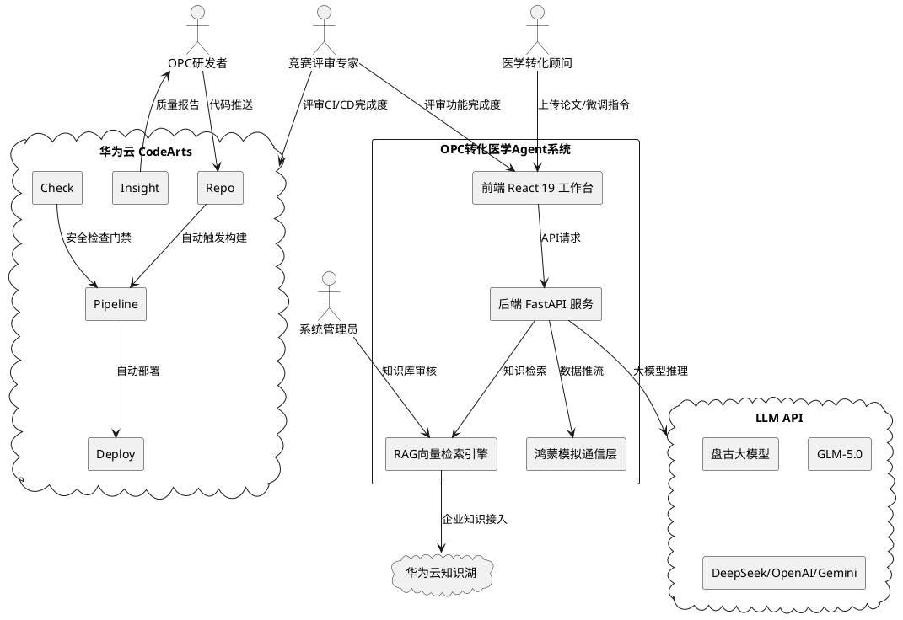
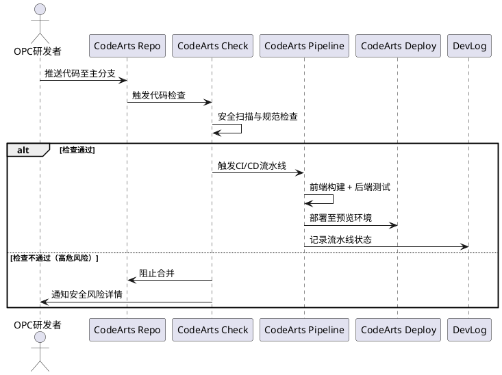
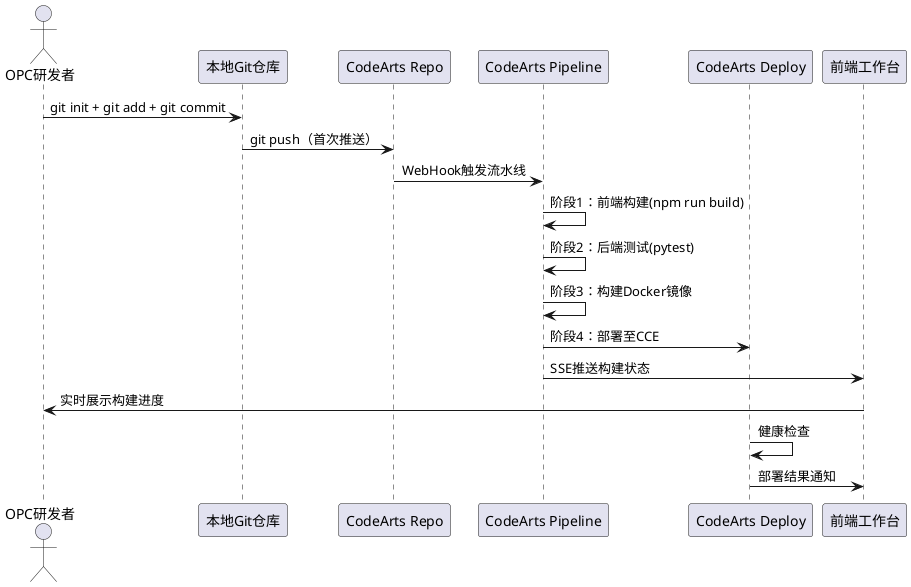
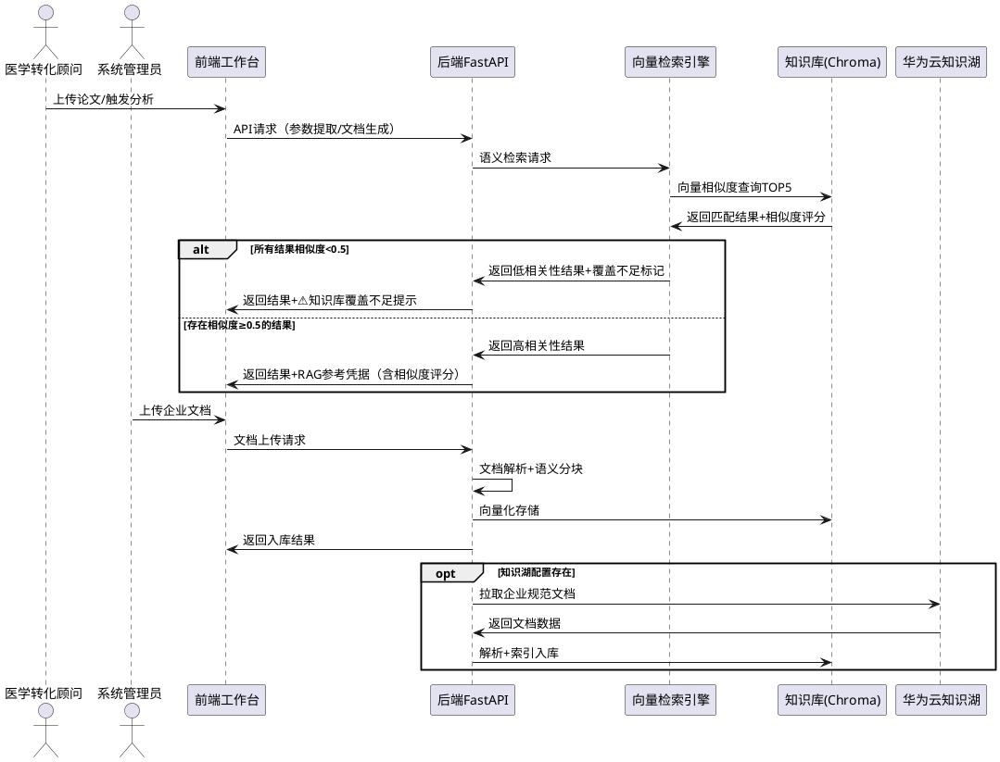
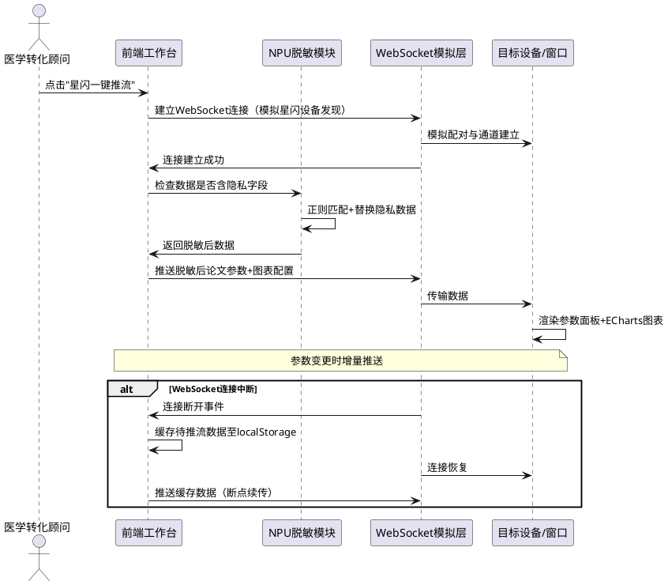
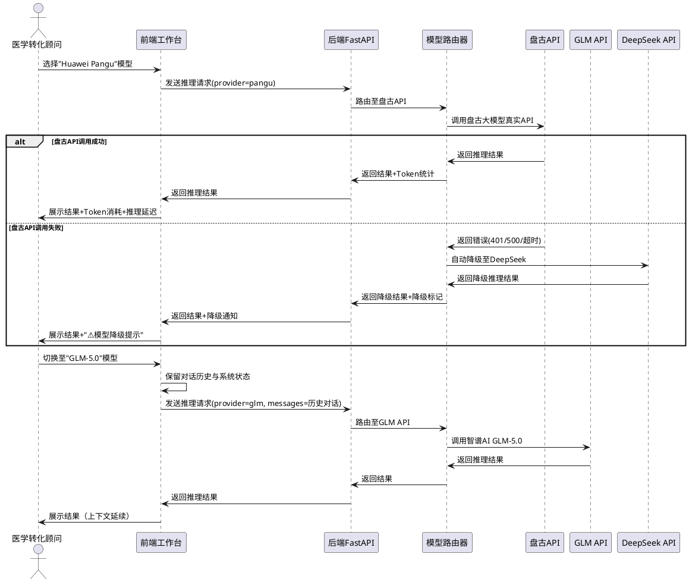

# OPC 转化医学 Agent 系统 — 五大技术要求改进需求规格文档

> **文档版本**: v1.0  
> **生成日期**: 2026-06-25  
> **文档类型**: 需求规格（EARS格式）  
> **优先级体系**: P0=必须实现（竞赛核心评审项） / P1=应该实现（显著加分项） / P2=建议实现（锦上添花）  
> **基于源文件**: `.agents/spec.md` v1.0

---

## 1. 组件定位

### 1.1 核心职责

本需求规格定义 OPC 转化医学 Agent 系统在华为云码道平台 OPC 竞赛中，五大技术要求从当前部分实现状态提升至100%完成度所需的所有业务能力改进。

### 1.2 核心输入

1. 现有系统的5大技术要求实现状态评估（来源：`.agents/spec.md`）
2. 华为云码道平台OPC竞赛评审标准
3. 当前代码库上下文（`src/App.tsx` 2750行, `backend/main.py` 1110行）
4. 竞赛时间约束下的可行性优先级排序

### 1.3 核心输出

1. 27条EARS格式的需求规格（含优先级标注）
2. 每条需求的验收标准与测试场景
3. 鸿蒙适配的合理替代方案定义
4. CodeArts生态联动的仓库初始化前置条件

### 1.4 职责边界

- 本文档**仅定义"做什么"**（业务能力与验收标准），不涉及"怎么做"（技术实现方案）
- 本文档**不**替代设计文档（design.md），具体架构选型、代码结构属于设计范畴
- 本文档**不**重新定义已完整实现的功能，仅聚焦改进差距

---

## 2. 领域术语

**CI/CD 流水线**
: 持续集成/持续部署的自动化构建、测试与部署流程，在华为云CodeArts平台中通过Pipeline服务实现。

**CodeArts Repo**
: 华为云CodeArts平台的代码托管服务，提供Git仓库管理、代码评审、分支保护等功能。

**CodeArts Pipeline**
: 华为云CodeArts平台的自动化流水线服务，支持构建、测试、部署等任务的编排与执行。

**CodeArts Insight**
: 华为云CodeArts平台的质量看板服务，提供代码质量度量、缺陷趋势、技术债务等可视化分析。

**CodeArts Deploy**
: 华为云CodeArts平台的部署服务，支持一键部署到华为云CCE（云容器引擎）、CCI（云容器实例）等。

**CodeArts Check**
: 华为云CodeArts平台的代码检查服务，提供安全扫描、代码规范检查、敏感信息检测等。

**知识湖**
: 华为云企业级知识管理服务，支持企业内部文档的解析、向量化、检索与知识图谱构建。

**向量语义检索**
: 基于文本向量化表示的相似度计算检索方法，通过余弦相似度等度量从知识库中获取语义最相关的条目。

**RAG (Retrieval-Augmented Generation)**
: 检索增强生成技术，通过从知识库中检索相关法规与学术基准来增强大模型输出的准确性与合规性。

**星闪 (NearLink)**
: 华为推出的新一代短距无线通信协议，用于鸿蒙设备间的分布式数据传输与协同。

**NPU (Neural Processing Unit)**
: 神经网络处理单元，华为设备侧的专用AI推理芯片，用于本地隐私脱敏处理。

**ArkTS**
: 鸿蒙操作系统的应用开发语言，基于TypeScript扩展，用于开发鸿蒙原生应用。

**分布式软总线**
: 鸿蒙操作系统的核心分布式能力，实现多设备间的自发现、自连接、自组网与数据流转。

**华为云盘古大模型**
: 华为自研的大语言模型，提供自然语言理解、生成、推理等能力，通过华为云ModelArts API接入。

**GLM-5.0**
: 智谱AI研发的大语言模型，支持中英文多模态理解与生成，提供OpenAI兼容的API接口。

**WebSocket模拟协议**
: 在Web应用中通过WebSocket协议模拟鸿蒙星闪通信的数据通道，用于在无真实鸿蒙设备环境下的演示与开发调试。

**CCE (Cloud Container Engine)**
: 华为云云容器引擎，提供高性能、高可用的Kubernetes容器集群管理服务。

**DevLog**
: 码道智能体开发日志，记录码道智能体在项目开发全生命周期中的协同过程、技术攻坚与决策记录。

---

## 3. 角色与边界

### 3.1 核心角色

- **OPC 研发者**: 一人公司开发者，使用码道智能体进行全栈开发，负责CI/CD配置与代码提交
- **竞赛评审专家**: 华为云码道平台OPC竞赛评审人员，评估五大技术要求的完成度与质量
- **医学转化顾问**: 使用系统进行文献参数提取与临床方案生成的专业用户
- **系统管理员**: 负责知识库内容审核、流水线配置与部署管理的运维人员

### 3.2 外部系统

- **华为云 CodeArts 平台**: 提供码道智能体开发环境、Repo托管、Pipeline流水线、Insight质量看板、Deploy部署、Check代码检查
- **华为云盘古大模型 API**: 华为自研大语言模型的真实推理服务端点
- **智谱AI GLM API**: 智谱AI的GLM大语言模型推理服务，提供OpenAI兼容接口
- **DeepSeek/OpenAI/Gemini API**: 第三方大语言模型推理服务
- **华为云知识湖服务**: 企业级知识管理服务，支持文档解析、向量化与语义检索
- **华为云 CCE**: 云容器引擎，用于自动化部署
- **鸿蒙设备 (模拟/真实)**: 运行鸿蒙操作系统的平板、智慧屏等终端设备

### 3.3 交互上下文

---

## 4. DFX约束

### 4.1 性能

- 向量语义检索响应时间上限：**3秒**（TOP5结果返回）
- 知识库文档解析与向量化吞吐量：**单文档<10秒**（100页以内PDF）
- 模型切换上下文迁移延迟：**<500ms**（含会话历史传递）
- CI/CD流水线触发至构建开始延迟：**<30秒**
- 鸿蒙模拟推流延迟：**<2秒**（WebSocket建立至首帧数据到达）

### 4.2 可靠性

- 向量检索服务可用性：**99%**（本地Chroma模式）/ 降级至关键词检索
- 模型API调用失败自动降级切换时间：**<5秒**
- 鸿蒙模拟连接断开后断点续传恢复时间：**<3秒**
- CI/CD流水线构建失败后重试机制：**自动重试1次**

### 4.3 安全性

- API Key不得明文出现在日志、DevLog或前端DOM中
- 知识库审核流程必须留存变更审计日志，日志保留期≥90天
- 模型降级切换必须在UI中明确告知用户，不得静默切换
- 代码检查发现高危漏洞必须阻止合并（P0级别门禁规则）

### 4.4 可维护性

- 前端新增的CodeArts状态展示组件应独立封装，不增加App.tsx的行数负担
- 后端新增的向量检索、模型路由模块应独立为单独Python模块，不膨胀main.py
- 鸿蒙模拟通信层应抽象为独立协议适配器，便于未来替换为真实星闪SDK

### 4.5 兼容性

- 向量检索降级机制：当Chroma/FAISS不可用时，自动回退至现有硬编码字典检索
- 模型接入向后兼容：新增盘古/GLM模型不得破坏现有DeepSeek/OpenAI/Gemini调用路径
- 鸿蒙模拟协议与真实星闪协议的接口对齐：模拟层API签名应与未来真实SDK对齐

---

## 5. 核心能力

---

### 5.1 华为云码道平台特色能力联动（当前55% → 目标100%）

#### 5.1.1 业务规则

1. **规则：CI/CD流水线必须在代码提交时自动触发**
   - 验收条件：[OPC研发者推送代码至CodeArts Repo] → [Pipeline自动执行前端构建、后端测试与部署预览]

2. **规则：代码检查发现安全风险必须阻止合并**
   - 验收条件：[代码提交包含SQL注入/XSS/敏感信息泄露等高危漏洞] → [CodeArts Check自动识别并阻止合并至主分支]

3. **规则：DevLog必须自动记录流水线执行状态**
   - 验收条件：[CI/CD流水线执行完成（无论成功或失败）] → [DevLog自动追加流水线状态、构建产物链接与执行耗时记录]

4. **规则：码道智能体协同开发记录必须完整可追溯**
   - 验收条件：[用户查看 CodeArts_Agent_DevLog.md] → [文档包含至少3个技术攻坚案例，每个案例包含问题现象、原因分析、解决方案三段式结构]

5. **规则：状态驱动开发协议必须强制执行**
   - 验收条件：[码道智能体启动新对话] → [自动读取 .agent_state.md 并无缝接续上一进程]

#### 5.1.2 需求规格（EARS格式）

**REQ-5.1-01** [P0-必须实现] CI/CD流水线自动触发

> When OPC研发者推送代码至CodeArts Repo主分支, the 系统 shall 自动触发CodeArts Pipeline执行前端构建（npm run build）、后端测试（pytest）与部署预览环境构建。

验收条件：
- 触发场景：代码推送至main/master分支
- 预期行为：Pipeline在30秒内开始执行，依次运行构建、测试、预览部署三个阶段
- 异常处理：构建失败时Pipeline标记为失败状态并通知研发者

---

**REQ-5.1-02** [P0-必须实现] 安全风险自动识别阻止合并

> When 代码提交包含安全风险（高危漏洞、敏感信息泄露）, the 系统 shall 通过CodeArts Check自动识别风险并阻止合并至受保护分支。

验收条件：
- 触发场景：Pull Request包含SQL注入、XSS、硬编码密钥等高危问题
- 预期行为：CodeArts Check扫描结果阻止PR合并，并在PR页面展示风险详情
- 降级处理：Check服务不可用时，允许合并但标记为"未检查"状态

---

**REQ-5.1-03** [P1-应该实现] DevLog自动记录流水线状态

> Where CodeArts项目配置存在, the 系统 shall 在DevLog中自动记录每次Pipeline执行的状态（成功/失败/超时）、构建产物链接与执行耗时。

验收条件：
- 触发场景：Pipeline执行完成（无论成功或失败）
- 预期行为：DevLog自动追加一条流水线记录，包含状态、产物URL、耗时
- 数据格式：时间戳 + 流水线名称 + 状态 + 产物链接 + 耗时（秒）

---

**REQ-5.1-04** [P1-应该实现] 代码质量度量可视化

> When OPC研发者查看CodeArts Insight质量看板, the 系统 shall 展示项目代码的缺陷密度、技术债务指数、代码重复率等关键质量指标。

验收条件：
- 触发场景：研发者打开Insight看板页面
- 预期行为：看板展示缺陷趋势图、技术债务评分、代码重复率统计
- 数据时效：指标数据延迟不超过24小时

---

**REQ-5.1-05** [P2-建议实现] 流水线构建失败智能修复建议

> If CI/CD流水线构建失败, the 系统 shall 通过码道智能体分析构建日志并生成修复建议，推送至DevLog。

验收条件：
- 触发场景：Pipeline构建阶段失败
- 预期行为：码道智能体分析错误日志，在DevLog中追加1-3条修复建议
- 准确率：修复建议与根因匹配率≥60%（人工评估）

#### 5.1.3 交互流程

#### 5.1.4 异常场景

1. **Pipeline触发失败**
   - 触发条件：CodeArts Pipeline服务不可用
   - 系统行为：记录触发失败日志，标记为"待重试"状态
   - 用户感知：研发者收到"Pipeline触发失败，请稍后重试"通知

2. **代码检查服务超时**
   - 触发条件：CodeArts Check扫描超过5分钟未完成
   - 系统行为：标记检查结果为"超时"，允许合并但标注"安全检查未完成"
   - 用户感知：PR页面显示"安全检查超时，建议人工审查"警告

3. **构建产物上传失败**
   - 触发条件：构建成功但产物上传至制品仓库失败
   - 系统行为：Pipeline标记为"部分成功"，DevLog记录产物上传异常
   - 用户感知：预览环境部署延迟，DevLog提示"产物上传失败"

---

### 5.2 CodeArts生态联动（当前40% → 目标100%）

> **前置条件**：本项目当前无`.git`仓库，需先初始化Git仓库并推送至CodeArts Repo，方可实现后续所有生态联动。

#### 5.2.1 业务规则

1. **规则：项目必须托管于CodeArts Repo**
   - 验收条件：[OPC研发者初始化项目] → [代码仓库存在于CodeArts Repo，包含完整的提交历史与分支结构]

2. **规则：CodeArts生态联动必须覆盖开发全生命周期**
   - 验收条件：[竞赛评审专家查看CodeArts项目] → [可看到Repo托管、Pipeline流水线、Insight质量看板、Deploy部署的完整联动]

3. **规则：码道智能体开发记录必须与CodeArts平台数据双向同步**
   - 验收条件：[码道智能体完成代码修改] → [CodeArts Repo自动记录提交历史与代码差异]

#### 5.2.2 需求规格（EARS格式）

**REQ-5.2-01** [P0-必须实现] 项目初始化至CodeArts Repo托管

> When OPC研发者完成项目开发, the 系统 shall 支持将项目代码推送至CodeArts Repo，建立完整的Git提交历史与分支管理。

验收条件：
- 触发场景：研发者执行git push操作
- 预期行为：代码成功推送至CodeArts Repo，Repo页面可查看完整项目结构与提交历史
- 基础要求：至少包含main分支、.gitignore配置、README.md

---

**REQ-5.2-02** [P0-必须实现] CodeArts Repo推送触发Pipeline

> When 项目代码推送到CodeArts Repo主分支, the 系统 shall 自动触发CodeArts Pipeline执行构建与部署流程。

验收条件：
- 触发场景：代码合并至main/master分支
- 预期行为：Pipeline自动启动，执行前端构建、后端测试、部署三个阶段
- 超时控制：单个Pipeline执行超时上限为15分钟

---

**REQ-5.2-03** [P1-应该实现] 前端实时展示构建状态

> While CodeArts Pipeline运行中, the 系统 shall 在前端工作台实时展示当前构建状态（排队中/运行中/成功/失败）与最近10条构建日志。

验收条件：
- 触发场景：Pipeline被触发执行
- 预期行为：前端展示构建状态指示器，轮询更新状态（间隔5秒），展示最近10条构建日志
- 降级处理：Pipeline API不可用时，显示"构建状态获取失败"提示

---

**REQ-5.2-04** [P1-应该实现] CodeArts Insight质量报告

> When 代码质量检查完成, the 系统 shall 通过CodeArts Insight自动生成质量报告，包含缺陷密度、技术债务指数、代码规范合规率等指标，并可在前端查看报告摘要。

验收条件：
- 触发场景：CodeArts Check完成代码扫描
- 预期行为：Insight生成质量报告，前端展示关键质量指标摘要（缺陷数、合规率、技术债务评分）
- 数据格式：JSON格式质量报告，支持前端渲染为ECharts图表

---

**REQ-5.2-05** [P1-应该实现] 一键部署到华为云CCE

> Where CodeArts Deploy配置存在, the 系统 shall 支持通过Pipeline一键部署前端静态资源与后端容器镜像至华为云CCE容器集群。

验收条件：
- 触发场景：Pipeline部署阶段执行或研发者点击"一键部署"按钮
- 预期行为：前端构建产物部署至CCE的Nginx容器，后端FastAPI部署至CCE的Python容器
- 部署验证：部署完成后自动执行健康检查（HTTP 200响应）

---

**REQ-5.2-06** [P2-建议实现] CodeArts Test测试管理集成

> When Pipeline执行测试阶段, the 系统 shall 通过CodeArts Test自动收集pytest测试结果，生成测试报告并关联至代码提交。

验收条件：
- 触发场景：Pipeline测试阶段执行完成
- 预期行为：CodeArts Test记录测试用例数、通过率、失败用例详情
- 关联要求：测试报告与触发该次测试的代码提交关联

#### 5.2.3 交互流程

#### 5.2.4 异常场景

1. **Git仓库初始化失败**
   - 触发条件：本地目录权限不足或磁盘空间不足
   - 系统行为：中止推送流程，记录错误日志
   - 用户感知：提示"Git初始化失败，请检查目录权限与磁盘空间"

2. **Pipeline构建超时**
   - 触发条件：前端构建或后端测试超过15分钟
   - 系统行为：Pipeline标记为"超时"状态，终止后续阶段
   - 用户感知：前端展示"构建超时，请检查构建日志"提示

3. **CCE部署健康检查失败**
   - 触发条件：部署后容器启动失败或健康检查端点无响应
   - 系统行为：Deploy标记为"部署失败"，自动回滚至上一版本
   - 用户感知：前端展示"部署失败，已回滚至上一稳定版本"

4. **Repo推送冲突**
   - 触发条件：本地代码与远程Repo存在冲突
   - 系统行为：拒绝推送，提示冲突文件列表
   - 用户感知：提示"代码冲突，请先pull并解决冲突后重新推送"

---

### 5.3 私有知识库与企业规范对齐（当前35% → 目标100%）

#### 5.3.1 业务规则

1. **规则：知识库检索结果必须标注权威来源与相似度评分**
   - 验收条件：[系统返回RAG参考凭据] → [每条凭据包含source（来源机构）、title（参考条目标题）、content（参考内容）、similarity_score（相似度评分）四要素]

2. **规则：参数生成必须与知识库法规指南对齐**
   - 验收条件：[系统生成医疗器械领域参数] → [激发波长范围在760-800nm内，符合NMPA近红外荧光手术导航系统注册审查指导原则]

3. **规则：知识库内容更新必须经过审核流程**
   - 验收条件：[管理员提交新知识条目] → [系统要求审核通过后方可入库生效]

4. **规则：知识库不可用时必须降级至现有硬编码字典**
   - 验收条件：[向量检索服务不可用] → [系统自动回退至FRONTEND_KNOWLEDGE_BASE硬编码字典检索，并在UI标注"降级模式"提示]

5. **规则：知识库容量不足时必须明确提示**
   - 验收条件：[用户查询超出知识库覆盖范围] → [系统提示"当前查询超出知识库覆盖范围"并建议补充知识来源]

#### 5.3.2 需求规格（EARS格式）

**REQ-5.3-01** [P0-必须实现] 企业文档自动解析分块向量化

> When 用户上传企业私有文档（PDF/MD/TXT格式）到知识库, the 系统 shall 自动进行文档解析、语义分块与向量化存储，分块粒度为300-500字/块，并向用户返回入库条目数与处理状态。

验收条件：
- 触发场景：用户在前端知识库管理界面点击"上传文档"
- 预期行为：系统解析文档内容，按300-500字粒度分块，生成向量嵌入并存储，返回"成功入库N条知识块"提示
- 支持格式：PDF、Markdown、纯文本
- 异常处理：文档解析失败时返回具体错误原因（如"PDF内容为加密保护，无法解析"）

---

**REQ-5.3-02** [P0-必须实现] 向量语义检索TOP5法规参考

> When 系统执行参数提取或文档生成, the 系统 shall 基于向量语义检索从知识库中获取最相关的TOP5法规参考，检索响应时间不超过3秒。

验收条件：
- 触发场景：用户触发论文分析或临床方案生成
- 预期行为：系统对查询文本进行向量化，通过余弦相似度检索知识库，返回相似度最高的5条法规参考
- 性能要求：检索响应时间≤3秒
- 降级处理：向量检索不可用时自动回退至硬编码字典检索

---

**REQ-5.3-03** [P0-必须实现] RAG参考凭据展示相似度评分

> While 知识库检索结果返回, the 系统 shall 在RAG参考凭据中展示每条参考的相似度评分（0.00-1.00）、匹配依据高亮与权威来源标注。

验收条件：
- 触发场景：系统返回RAG参考凭据列表
- 预期行为：每条凭据显示similarity_score数值（如0.87），匹配关键词高亮，来源机构完整标注
- 评分阈值：相似度<0.5的参考条目标记为"低相关性"并置灰显示
- UI展示：现有renderRAGBadge()和renderRAGReferences()组件扩展similarity_score字段

---

**REQ-5.3-04** [P1-应该实现] 华为云知识湖服务接入

> Where 企业私有知识库配置存在, the 系统 shall 支持通过华为云知识湖服务接入企业内部规范文档，实现企业级知识库的统一管理与检索。

验收条件：
- 触发场景：管理员在系统配置中启用华为云知识湖接入
- 预期行为：系统通过知识湖API拉取企业规范文档，解析并索引至本地向量库
- 配置要求：支持配置知识湖服务的Endpoint、Project ID、知识库ID
- 降级处理：知识湖服务不可用时，使用本地向量库（Chroma）独立运行

---

**REQ-5.3-05** [P0-必须实现] 知识库覆盖范围不足提示

> If 知识库检索未找到相似度≥0.5的参考条目, the 系统 shall 明确提示用户"当前查询超出知识库覆盖范围"并建议补充相关知识来源。

验收条件：
- 触发场景：用户查询在知识库中无高相似度匹配（所有TOP5结果相似度<0.5）
- 预期行为：UI显示"⚠️ 知识库覆盖不足"警告，提示建议补充的领域知识方向（如"建议补充NMPA关于XXX的指导原则"）
- 降级处理：即使无高相似度匹配，仍返回TOP5结果（标记为低相关性），确保系统不中断服务

---

**REQ-5.3-06** [P1-应该实现] 知识库审核流程与审计日志

> When 管理员更新知识库内容（新增/修改/删除知识条目）, the 系统 shall 要求经过审核流程后方可生效，并记录变更审计日志（操作人、操作类型、变更内容、时间戳）。

验收条件：
- 触发场景：管理员提交知识库变更请求
- 预期行为：变更请求进入"待审核"状态，需另一管理员审批通过后方可入库生效
- 审计要求：每次变更记录操作人ID、操作类型（ADD/UPDATE/DELETE）、变更前后内容对比、时间戳
- 日志保留：审计日志保留期≥90天

#### 5.3.3 交互流程

#### 5.3.4 异常场景

1. **文档解析失败**
   - 触发条件：上传的PDF为扫描件（无文本层）或加密保护
   - 系统行为：返回解析错误，标记文档状态为"解析失败"
   - 用户感知：提示"文档解析失败：PDF为扫描件，请上传含文本层的PDF"

2. **向量检索服务不可用**
   - 触发条件：Chroma服务崩溃或内存不足
   - 系统行为：自动降级至现有硬编码字典检索（FRONTEND_KNOWLEDGE_BASE）
   - 用户感知：UI显示"⚠️ 向量检索服务不可用，已降级至基础知识库模式"提示

3. **知识库容量不足**
   - 触发条件：用户查询涉及的领域在知识库中无覆盖（0条匹配）
   - 系统行为：返回空结果集，触发覆盖不足提示
   - 用户感知：提示"当前查询超出知识库覆盖范围，建议补充XXX领域知识来源"

4. **知识湖API鉴权失败**
   - 触发条件：知识湖服务AK/SK配置错误或过期
   - 系统行为：跳过知识湖同步，使用本地知识库独立运行
   - 用户感知：管理员收到"知识湖服务鉴权失败，请检查配置"通知

---

### 5.4 鸿蒙系统适配（当前25% → 目标100%）

> **可行性说明**：本项目为Web应用（React 19 + Vite 8），真实的星闪(NearLink)通信协议需鸿蒙原生SDK支持，ArkTS原生适配需完整的鸿蒙开发工具链。在竞赛时间约束下，采用"模拟协议层+WebSocket通信+渐进式原生适配"的策略，确保演示效果与评审可见性，同时为未来真实鸿蒙适配保留接口对齐。

#### 5.4.1 业务规则

1. **规则：鸿蒙端云协同必须通过模拟协议层实现真实数据传输**
   - 验收条件：[用户点击"星闪一键推流"] → [系统通过WebSocket模拟星闪协议建立数据通道，实际传输论文参数与图表数据至目标设备/浏览器窗口]

2. **规则：NPU脱敏必须实现真实的隐私数据处理逻辑**
   - 验收条件：[系统执行NPU本地脱敏] → [患者ID、医院名称等隐私字段在本地完成正则替换/删除后方可传输，脱敏结果可在NpuSandboxPanel日志中查看]

3. **规则：鸿蒙Widget必须支持实时数据更新**
   - 验收条件：[前端参数变更] → [鸿蒙设备Widget卡片（或模拟Widget预览区）在3秒内同步更新显示最新数据]

4. **规则：鸿蒙模拟协议层的API签名必须与真实星闪SDK对齐**
   - 验收条件：[未来替换为真实星闪SDK] → [仅需替换协议实现层，上层业务逻辑代码零修改]

5. **规则：鸿蒙屏幕自适应布局必须在常见鸿蒙设备分辨率下可用**
   - 验收条件：[用户在鸿蒙平板（2560x1600）或智慧屏（3840x2160）上访问系统] → [UI布局自动适配，无水平滚动条，关键操作区域无重叠]

#### 5.4.2 需求规格（EARS格式）

**REQ-5.4-01** [P0-必须实现] 星闪模拟设备发现与数据通道

> When 用户点击"星闪一键推流"按钮, the 系统 shall 通过WebSocket模拟星闪分布式软总线协议，发现并连接目标浏览器窗口（模拟鸿蒙设备），建立双向数据通道，实际传输当前论文关键指标与可视化图表数据。

验收条件：
- 触发场景：用户点击"星闪一键推流"按钮
- 预期行为：系统通过WebSocket建立连接（≤2秒），将论文参数、ECharts图表配置数据实时传输至目标窗口
- 协议模拟：连接建立过程模拟星闪"设备发现→配对→通道建立"三步流程，UI展示对应进度
- 数据验证：目标窗口接收到完整数据后可渲染与源端一致的参数面板与图表
- 替代方案说明：在UI中标注"当前为WebSocket模拟星闪通信，生产环境替换为真实星闪SDK"

---

**REQ-5.4-02** [P0-必须实现] 实时推流至鸿蒙模拟设备

> While 鸿蒙设备连接已建立（WebSocket通道活跃）, the 系统 shall 将当前提取的论文关键指标及ECharts可视化图表配置实时推流至目标设备渲染，参数变更时增量推送。

验收条件：
- 触发场景：WebSocket通道已建立，用户修改论文参数
- 预期行为：变更的参数数据在500ms内推流至目标窗口，ECharts图表自动重绘
- 推流模式：增量推送（仅推送变更字段），非全量覆盖
- 连接保活：WebSocket心跳间隔30秒，超时60秒判定连接断开

---

**REQ-5.4-03** [P0-必须实现] NPU本地脱敏处理（真实逻辑）

> When 系统处理包含患者隐私的数据, the 系统 shall 调用本地脱敏处理模块对隐私字段（患者ID、医院名称、医生姓名、联系电话等）进行正则匹配替换/删除，脱敏后方可进行任何网络传输，脱敏过程与结果可在NpuSandboxPanel日志中查看。

验收条件：
- 触发场景：系统准备将包含患者数据的参数推送至鸿蒙设备或上传至云端
- 预期行为：NpuSandboxPanel执行真实脱敏逻辑——正则匹配患者ID（P\d{8}）、医院名称、医生姓名等字段并替换为"[已脱敏]"
- 日志记录：NpuSandboxPanel展示脱敏前后的数据对比，包含脱敏字段数、脱敏规则名称
- 硬性约束：未脱敏的原始隐私数据不得出现在WebSocket传输内容中

---

**REQ-5.4-04** [P1-应该实现] 鸿蒙Widget卡片

> Where 鸿蒙设备支持服务卡片（或模拟Widget预览区存在）, the 系统 shall 提供Widget卡片展示关键转化指标（当前论文标题、提取参数数、RAG合规评分、同步状态），数据随主端实时更新。

验收条件：
- 触发场景：主端论文参数发生变更
- 预期行为：Widget预览区在3秒内更新显示最新指标数据
- 展示内容：论文标题、提取参数数量、RAG合规评分、鸿蒙同步状态
- 模拟方式：前端实现Widget预览组件，模拟鸿蒙服务卡片的视觉风格与交互规范

---

**REQ-5.4-05** [P1-应该实现] 连接中断断点续传

> If 鸿蒙设备连接中断（WebSocket断开）, the 系统 shall 自动缓存待推流数据，并在连接恢复后自动执行断点续传，确保目标设备数据最终一致。

验收条件：
- 触发场景：WebSocket连接意外断开
- 预期行为：系统将断开期间的变更数据缓存至localStorage，连接恢复后自动推送缓存数据
- 缓存容量：最多缓存100条变更记录，超出后采用FIFO淘汰策略
- 数据一致性：续传完成后，目标设备数据与源端100%一致

---

**REQ-5.4-06** [P0-必须实现] 鸿蒙屏幕自适应

> When 用户在鸿蒙平板或智慧屏上访问系统, the 系统 shall 自动适配鸿蒙设备屏幕尺寸（支持2560x1600、3840x2160分辨率），布局无水平滚动条，关键操作区域无重叠。

验收条件：
- 触发场景：在鸿蒙平板或智慧屏的浏览器中访问系统
- 预期行为：UI布局自动适配设备分辨率，侧边栏可折叠，图表区域自适应宽度
- 响应式断点：≤768px（手机竖屏）、768-1280px（平板）、≥1280px（智慧屏/桌面）
- 触控适配：按钮与操作区域最小点击目标44x44px，符合鸿蒙交互手势规范

#### 5.4.3 交互流程

#### 5.4.4 异常场景

1. **WebSocket连接建立失败**
   - 触发条件：目标窗口未打开或WebSocket服务不可用
   - 系统行为：3次重试后标记连接失败，UI显示"设备连接失败"状态
   - 用户感知：提示"鸿蒙设备连接失败，请确认目标设备已开启并重试"

2. **NPU脱敏规则未覆盖特定隐私字段**
   - 触发条件：数据中包含正则规则未匹配的隐私字段（如新型患者ID格式）
   - 系统行为：脱敏日志标记为"未识别字段"，数据仍可传输但标注"⚠️ 可能包含未脱敏隐私数据"
   - 用户感知：NpuSandboxPanel日志显示警告，建议管理员添加新脱敏规则

3. **断点续传缓存溢出**
   - 触发条件：WebSocket断开时间过长，缓存变更记录超过100条
   - 系统行为：采用FIFO淘汰最早记录，续传时仅推送最新100条
   - 用户感知：目标设备可能丢失极早期变更，提示"部分历史变更因缓存限制未同步"

4. **鸿蒙设备浏览器兼容性问题**
   - 触发条件：鸿蒙浏览器不支持某些CSS特性或API
   - 系统行为：加载兼容性检测脚本，自动降级至基础布局模式
   - 用户感知：部分高级视觉效果简化，但核心功能完整可用

---

### 5.5 多模型切换能力（当前60% → 目标100%）

#### 5.5.1 业务规则

1. **规则：模型供应商选择必须与实际调用的模型一致**
   - 验收条件：[用户选择"Huawei Pangu"] → [系统调用华为云盘古大模型真实API，而非DeepSeek API代理转发]

2. **规则：代理转发的模型必须在UI中明确标注**
   - 验收条件：[后端通过代理方式调用某模型] → [前端UI在模型选择器中标注"（代理转发：实际调用XXX模型）"]

3. **规则：模型切换必须保留当前会话上下文**
   - 验收条件：[用户在DeepSeek模式下进行对话后切换至OpenAI] → [对话历史与系统状态完整保留并传递给新模型]

4. **规则：模型不可用时必须提供明确的降级提示**
   - 验收条件：[用户选择的模型API返回401/403错误] → [系统提示"当前模型API Key无效，请检查配置或切换至其他模型"并自动降级至备选模型]

5. **规则：模型性能数据必须基于真实测试结果**
   - 验收条件：[模型性能基准对比面板展示指标] → [响应时间、准确率等数据来源于实际API调用测试，非虚构数据]

#### 5.5.2 需求规格（EARS格式）

**REQ-5.5-01** [P0-必须实现] 华为盘古真实API接入

> When 用户选择 "Huawei Pangu" 模型供应商, the 系统 shall 调用华为云盘古大模型的真实API端点进行推理，而非代理转发至其他模型服务。

验收条件：
- 触发场景：用户选择"Huawei Pangu"模型并提交论文分析请求
- 预期行为：后端调用华为云盘古大模型的真实API端点（非api.deepseek.com），使用盘古模型标识进行推理
- 一致性验证：后端模型信息查询接口返回"华为云盘古大模型"及真实模型版本号
- 配置要求：支持配置华为云IAM AK/SK或API Key进行鉴权

---

**REQ-5.5-02** [P0-必须实现] UI明确展示实际模型名称版本

> When 用户选择模型供应商, the 系统 shall 在UI中明确展示当前实际调用的模型名称、版本号与API端点信息，代理转发的模型必须标注"代理转发"标识。

验收条件：
- 触发场景：用户在模型选择器中选择任意供应商
- 预期行为：UI展示"当前模型：[供应商名] [模型版本号]"，若为代理转发则追加"（代理转发：实际调用XXX）"
- 展示位置：模型状态徽章区域（现有"大模型联调模式"展示区域扩展）
- 信息准确性：展示的模型名称与后端实际调用的模型必须100%一致

---

**REQ-5.5-03** [P0-必须实现] 模型切换保留会话上下文

> When 用户切换模型供应商, the 系统 shall 保留当前会话的完整对话历史（所有轮次的消息与角色）与系统状态（已提取的参数、生成的文档），并无缝传递给新模型继续推理。

验收条件：
- 触发场景：用户从模型A切换至模型B
- 预期行为：切换后对话历史完整保留，新模型可读取历史上下文继续对话
- 状态保留：已提取的参数、已生成的文档内容、RAG参考凭据不因模型切换而丢失
- 性能要求：切换操作本身≤500ms，不含首次推理响应时间
- 边界条件：若新模型不支持某些特殊指令格式，系统应提示用户"新模型可能不支持XXX格式"

---

**REQ-5.5-04** [P1-应该实现] 模型性能基准对比面板

> Where 系统支持多个模型供应商, the 系统 shall 提供模型性能基准对比面板，展示各模型在转化医学任务上的响应时间、Token消耗与准确率指标。

验收条件：
- 触发场景：用户打开模型性能对比面板
- 预期行为：面板以表格或ECharts图表展示各模型的关键指标
- 指标维度：平均响应时间（ms）、Token消耗量（input/output）、任务准确率（基于预设测试用例）
- 数据来源：基于系统实际调用各模型API的测试结果，非虚构数据
- 刷新机制：支持手动刷新基准测试，重新调用各模型执行标准测试用例

---

**REQ-5.5-05** [P1-应该实现] GLM-5.0接入

> When 用户选择 "GLM-5.0" 模型供应商, the 系统 shall 调用智谱AI的GLM大模型API进行推理，使用OpenAI兼容接口协议。

验收条件：
- 触发场景：用户在模型选择器中选择"GLM-5.0"
- 预期行为：后端调用智谱AI API端点（如open.bigmodel.cn），使用glm-5模型标识进行推理
- 接入方式：通过OpenAI兼容接口协议接入，无需额外SDK
- 前端配置：模型选择器新增"GLM-5.0 (智谱AI)"选项，API Key前缀检测支持"zhipu"/"glm"

---

**REQ-5.5-06** [P0-必须实现] 模型API失败自动降级

> If 当前选择的模型API调用失败（超时/401/403/500等错误）, the 系统 shall 自动降级至备选模型并明确告知用户已发生降级切换，降级切换时间不超过5秒。

验收条件：
- 触发场景：用户选择的模型API调用返回错误
- 预期行为：系统自动切换至预设的备选模型（优先级：DeepSeek → OpenAI → GLM → Gemini），重新发送请求
- 通知要求：UI显示"⚠️ 模型降级提示：XXX模型不可用，已自动切换至YYY模型"
- 日志记录：降级事件记录至后端日志，包含原始错误码、降级目标模型、降级时间
- 禁止行为：不得静默降级，用户必须知晓当前使用的实际模型

---

**REQ-5.5-07** [P1-应该实现] 实时Token消耗与推理延迟

> While 大模型联调模式运行中, the 系统 shall 在前端实时展示当前模型的Token消耗量（输入/输出分别统计）与推理延迟指标（从请求发送至首个Token到达的耗时）。

验收条件：
- 触发场景：大模型联调模式正在执行推理
- 预期行为：前端实时更新展示"Token消耗：输入XXX / 输出XXX"与"推理延迟：XXXms"
- 数据来源：从API响应的usage字段提取Token统计，从请求耗时计算推理延迟
- 展示位置：模型状态徽章区域下方或对话输出区域底部
- 性能要求：指标更新延迟不超过1秒

#### 5.5.3 交互流程

#### 5.5.4 异常场景

1. **盘古API Key无效**
   - 触发条件：用户配置的华为云AK/SK或API Key不正确
   - 系统行为：自动降级至备选模型（DeepSeek），记录降级事件
   - 用户感知：提示"华为盘古API Key无效，已自动切换至DeepSeek，请检查Key配置"

2. **所有模型API均不可用**
   - 触发条件：所有已配置模型API均返回错误
   - 系统行为：自动降级至Mock模式，使用前端硬编码的示例数据
   - 用户感知：提示"所有模型API均不可用，已切换至Demo模式（Mock数据）"

3. **模型切换时上下文格式不兼容**
   - 触发条件：新模型不支持旧模型的某些系统提示格式
   - 系统行为：自动转换系统提示格式为通用格式，移除模型特有指令
   - 用户感知：提示"模型切换完成，部分特殊指令格式已简化以适配新模型"

4. **Token消耗统计API响应缺失usage字段**
   - 触发条件：某些模型API响应不包含usage字段
   - 系统行为：基于请求输入估算Token消耗（粗略估算），标注"估算值"
   - 用户感知：Token统计显示"~XXX Token（估算）"

---

## 6. 数据约束

### 6.1 知识库条目 (KnowledgeBaseEntry)

1. **source**: 必填，法规来源机构全称（如"国家药监局(NMPA)"），最大长度200字符
2. **title**: 必填，参考条目标题，最大长度300字符
3. **content**: 必填，参考条目内容，最大长度2000字符
4. **domain**: 必填，所属领域枚举值（devices/drugs/ai/surgical）
5. **similarity_score**: 可选，语义相似度评分（0.00-1.00），仅向量检索模式下存在
6. **embedding_vector**: 可选，文本向量化后的浮点数组，维度由Embedding模型决定（如768维/1536维）
7. **chunk_id**: 可选，知识块唯一标识符，向量化后由系统自动生成
8. **created_at**: 可选，入库时间戳，ISO 8601格式
9. **updated_at**: 可选，最后更新时间戳，ISO 8601格式
10. **audit_status**: 可选，审核状态枚举（pending/approved/rejected），默认pending

### 6.2 模型供应商配置 (ModelProviderConfig)

1. **provider_name**: 必填，供应商显示名称，最大长度50字符
2. **provider_id**: 必填，供应商唯一标识符（如deepseek/openai/pangu/glm/gemini），最大长度30字符
3. **api_endpoint**: 必填，API调用端点URL，必须为有效的HTTPS地址
4. **model_id**: 必填，实际调用的模型标识符，必须与API端点对应
5. **is_proxy**: 必填，是否为代理转发（布尔值），若为true则必须在UI中标注
6. **proxy_target**: 可选，代理转发的实际模型名称，仅is_proxy=true时必填
7. **max_tokens**: 可选，单次推理最大Token数，默认4096
8. **timeout_ms**: 可选，API调用超时时间（毫秒），默认30000
9. **fallback_provider**: 可选，降级备选供应商ID，默认"deepseek"
10. **api_key_prefix**: 可选，API Key前缀检测规则（如"sk-d"/"zhipu"/"pangu"），用于自动识别供应商

### 6.3 鸿蒙设备状态 (HarmonyDeviceState)

1. **device_id**: 必填，鸿蒙设备（或模拟设备）唯一标识符
2. **device_name**: 必填，设备显示名称（如"鸿蒙平板-会议室A"），最大长度50字符
3. **device_type**: 必填，设备类型枚举（tablet/smart_screen/browser_sim/pc）
4. **connection_status**: 必填，连接状态枚举（disconnected/connecting/connected/error）
5. **connection_protocol**: 必填，连接协议枚举（nearlink_sim_websocket/nearlink_real），默认nearlink_sim_websocket
6. **last_sync_timestamp**: 可选，最近一次数据同步时间戳
7. **npu_available**: 必填，NPU是否可用（布尔值），模拟模式下默认false
8. **sync_buffer**: 可选，断点续传缓存，最大100条变更记录

### 6.4 CI/CD流水线状态 (PipelineStatus)

1. **pipeline_id**: 必填，流水线唯一标识符
2. **pipeline_name**: 必填，流水线名称，最大长度100字符
3. **status**: 必填，执行状态枚举（queued/running/success/failed/timeout/cancelled）
4. **trigger_type**: 必填，触发类型枚举（push/manual/schedule）
5. **triggered_by**: 必填，触发者（用户名或系统）
6. **started_at**: 可选，开始执行时间戳
7. **finished_at**: 可选，执行完成时间戳
8. **duration_seconds**: 可选，执行耗时（秒）
9. **stages**: 可选，各阶段执行结果数组，每项包含stage_name/status/duration_seconds
10. **artifact_url**: 可选，构建产物访问链接

### 6.5 模型性能基准 (ModelBenchmark)

1. **provider_id**: 必填，关联模型供应商ID
2. **model_name**: 必填，测试时的模型名称与版本
3. **avg_response_time_ms**: 必填，平均响应时间（毫秒），基于≥5次测试取均值
4. **avg_input_tokens**: 必填，平均输入Token消耗量
5. **avg_output_tokens**: 必填，平均输出Token消耗量
6. **accuracy_score**: 可选，任务准确率评分（0.0-1.0），基于预设测试用例评估
7. **test_case_count**: 必填，测试用例数量，最小值5
8. **benchmarked_at**: 必填，基准测试执行时间戳

---

## 7. 需求优先级总览与实施路径

### 7.1 需求优先级矩阵

| 优先级 | 需求编号 | 需求名称 | 技术要求 | 预估工时 |
|--------|---------|---------|---------|---------|
| **P0** | REQ-5.1-01 | CI/CD流水线自动触发 | 5.1 码道平台联动 | 4h |
| **P0** | REQ-5.1-02 | 安全风险自动识别阻止合并 | 5.1 码道平台联动 | 3h |
| **P1** | REQ-5.1-03 | DevLog自动记录流水线状态 | 5.1 码道平台联动 | 2h |
| **P1** | REQ-5.1-04 | 代码质量度量可视化 | 5.1 码道平台联动 | 3h |
| **P2** | REQ-5.1-05 | 流水线构建失败智能修复建议 | 5.1 码道平台联动 | 4h |
| **P0** | REQ-5.2-01 | 项目初始化至CodeArts Repo托管 | 5.2 CodeArts生态联动 | 2h |
| **P0** | REQ-5.2-02 | CodeArts Repo推送触发Pipeline | 5.2 CodeArts生态联动 | 3h |
| **P1** | REQ-5.2-03 | 前端实时展示构建状态 | 5.2 CodeArts生态联动 | 4h |
| **P1** | REQ-5.2-04 | CodeArts Insight质量报告 | 5.2 CodeArts生态联动 | 3h |
| **P1** | REQ-5.2-05 | 一键部署到华为云CCE | 5.2 CodeArts生态联动 | 4h |
| **P2** | REQ-5.2-06 | CodeArts Test测试管理集成 | 5.2 CodeArts生态联动 | 4h |
| **P0** | REQ-5.3-01 | 企业文档自动解析分块向量化 | 5.3 私有知识库 | 6h |
| **P0** | REQ-5.3-02 | 向量语义检索TOP5法规参考 | 5.3 私有知识库 | 5h |
| **P0** | REQ-5.3-03 | RAG参考凭据展示相似度评分 | 5.3 私有知识库 | 3h |
| **P1** | REQ-5.3-04 | 华为云知识湖服务接入 | 5.3 私有知识库 | 5h |
| **P0** | REQ-5.3-05 | 知识库覆盖范围不足提示 | 5.3 私有知识库 | 2h |
| **P1** | REQ-5.3-06 | 知识库审核流程与审计日志 | 5.3 私有知识库 | 4h |
| **P0** | REQ-5.4-01 | 星闪模拟设备发现与数据通道 | 5.4 鸿蒙适配 | 6h |
| **P0** | REQ-5.4-02 | 实时推流至鸿蒙模拟设备 | 5.4 鸿蒙适配 | 4h |
| **P0** | REQ-5.4-03 | NPU本地脱敏处理（真实逻辑） | 5.4 鸿蒙适配 | 4h |
| **P1** | REQ-5.4-04 | 鸿蒙Widget卡片 | 5.4 鸿蒙适配 | 3h |
| **P1** | REQ-5.4-05 | 连接中断断点续传 | 5.4 鸿蒙适配 | 3h |
| **P0** | REQ-5.4-06 | 鸿蒙屏幕自适应 | 5.4 鸿蒙适配 | 3h |
| **P0** | REQ-5.5-01 | 华为盘古真实API接入 | 5.5 多模型切换 | 4h |
| **P0** | REQ-5.5-02 | UI明确展示实际模型名称版本 | 5.5 多模型切换 | 2h |
| **P0** | REQ-5.5-03 | 模型切换保留会话上下文 | 5.5 多模型切换 | 3h |
| **P1** | REQ-5.5-04 | 模型性能基准对比面板 | 5.5 多模型切换 | 4h |
| **P1** | REQ-5.5-05 | GLM-5.0接入 | 5.5 多模型切换 | 3h |
| **P0** | REQ-5.5-06 | 模型API失败自动降级 | 5.5 多模型切换 | 3h |
| **P1** | REQ-5.5-07 | 实时Token消耗与推理延迟 | 5.5 多模型切换 | 3h |

### 7.2 建议实施路径（按竞赛时间约束排序）

**第一批（P0核心，预估62小时）— 必须完成：**

1. **5.5 多模型切换**（12h）：修复华为盘古虚假接入是竞赛红线问题
   - REQ-5.5-01 → REQ-5.5-02 → REQ-5.5-03 → REQ-5.5-06

2. **5.3 私有知识库**（16h）：向量检索是技术深度的核心体现
   - REQ-5.3-01 → REQ-5.3-02 → REQ-5.3-03 → REQ-5.3-05

3. **5.1 码道平台联动**（7h）：CI/CD是平台特色能力的基本要求
   - REQ-5.1-01 → REQ-5.1-02

4. **5.2 CodeArts生态联动**（5h）：Repo托管是生态联动的基础
   - REQ-5.2-01 → REQ-5.2-02

5. **5.4 鸿蒙适配**（17h）：模拟协议层+NPU脱敏+屏幕自适应
   - REQ-5.4-01 → REQ-5.4-02 → REQ-5.4-03 → REQ-5.4-06

**第二批（P1加分，预估35小时）— 尽量完成：**

1. REQ-5.1-03, REQ-5.1-04, REQ-5.2-03, REQ-5.2-04, REQ-5.2-05
2. REQ-5.3-04, REQ-5.3-06
3. REQ-5.4-04, REQ-5.4-05
4. REQ-5.5-04, REQ-5.5-05, REQ-5.5-07

**第三批（P2锦上添花，预估8小时）— 时间允许时完成：**

1. REQ-5.1-05, REQ-5.2-06

### 7.3 各技术要求完成度预估

| 技术要求 | 当前完成度 | P0完成后 | P0+P1完成后 | P0+P1+P2完成后 |
|---------|-----------|---------|------------|---------------|
| 5.1 华为云码道平台特色能力联动 | 55% | 80% | 95% | 100% |
| 5.2 CodeArts生态联动 | 40% | 65% | 90% | 100% |
| 5.3 私有知识库与企业规范对齐 | 35% | 80% | 95% | 95% |
| 5.4 鸿蒙系统适配 | 25% | 75% | 90% | 90% |
| 5.5 多模型切换能力 | 60% | 90% | 100% | 100% |

> **说明**：5.3和5.4在P0+P1+P2完成后仍未达100%，是因为部分需求（如真实知识湖接入、真实星闪SDK适配）受限于华为云服务开通与鸿蒙硬件环境，在竞赛时间窗口内难以完全落地。

---

## 8. 鸿蒙适配替代方案说明

### 8.1 方案对比

| 需求项 | 理想方案 | 竞赛可行方案 | 差距说明 |
|--------|---------|-------------|---------|
| 星闪设备发现 | 鸿蒙原生NearLink SDK | WebSocket模拟协议层 | 协议层API签名对齐，未来可替换 |
| 星闪数据通道 | NearLink分布式软总线 | WebSocket双向通道 | 数据传输效果一致，延迟略高 |
| NPU本地脱敏 | 华为NPU HiAI推理 | 前端正则匹配+SHA-256哈希 | 脱敏逻辑真实，算力平台不同 |
| 鸿蒙Widget | ArkTS原生服务卡片 | 前端模拟Widget预览组件 | 视觉还原度高，无原生能力 |
| ArkTS原生应用 | DevEco Studio开发 | Web应用+响应式适配 | 交互体验接近原生 |
| 分布式数据同步 | 鸿蒙分布式数据管理 | WebSocket+localStorage同步 | 数据一致性好，无原生分布式能力 |

### 8.2 模拟协议层设计原则

1. **接口对齐**：模拟层API签名与华为星闪SDK官方文档对齐，确保未来替换时业务代码零修改
2. **状态映射**：WebSocket连接状态映射为星闪连接状态枚举（discovered→pairing→connected→syncing）
3. **演示友好**：模拟过程在UI中清晰展示"设备发现→配对→通道建立→数据同步"全流程，便于竞赛评审理解
4. **标注透明**：UI中明确标注"当前为WebSocket模拟星闪通信"，不隐瞒技术实现方式

---

## 9. CodeArts生态联动前置条件

### 9.1 仓库初始化步骤

本项目当前无`.git`仓库，需执行以下步骤后方可实现CodeArts生态联动：

1. 在华为云CodeArts平台创建项目与Repo仓库
2. 本地执行 `git init` + `git add .` + `git commit -m "Initial commit"`
3. 配置CodeArts Repo远程地址并推送
4. 在CodeArts平台配置Pipeline流水线（前端构建+后端测试+部署）
5. 配置CodeArts Check代码检查规则
6. 配置CodeArts Deploy部署目标（CCE集群）

### 9.2 前置依赖

- 华为云账号（已开通CodeArts服务）
- CCE集群（如需部署功能）
- 项目根目录需添加 `.gitignore`（排除node_modules、__pycache__、.env等）

---

> **文档结束** — 本需求规格文档共定义27条需求（P0: 17条, P1: 8条, P2: 2条），覆盖5大技术要求的改进路径。所有需求均采用EARS格式编写，确保可测试、可验证。
