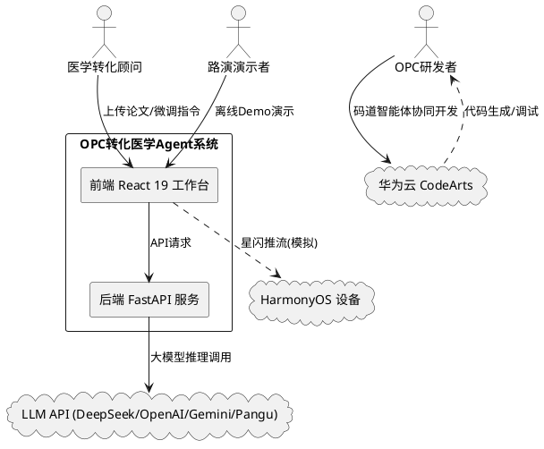

# OPC 转化医学 Agent 系统 — 华为云码道平台技术要求实现状态评估与需求规格
 
> **文档版本**: v1.0  
> **生成日期**: 2026-06-25  
> **基于代码版本**: ver2_antigravity_CodeArts  
> **核心文件**: `src/App.tsx` (2750行), `backend/main.py` (1110行)

---

## 1. 组件定位

### 1.1 核心职责

本系统负责将学术文献中的转化医学研究成果，通过多智能体协同机制，自动提取物理/药理/算法参数、匹配临床场景设备，并生成标准化临床方案与商业融资计划书。

### 1.2 核心输入

1. 用户上传的学术论文（PDF/MD/TXT 格式）
2. 用户的自然语言微调指令（如"将半衰期修改为3小时"）
3. 用户的 API Key 配置（用于大模型联调模式）
4. 用户选择的模型供应商（DeepSeek/OpenAI/OpenRouter/Gemini/Huawei Pangu）

### 1.3 核心输出

1. 从论文中提取的领域参数（激发波长、半衰期、诊断精度等）
2. 匹配的 TOP3 临床基地/CDMO/PACS 系统推荐
3. 自动生成的《临床试验方案草案》和《商业融资计划书》
4. RAG 知识库比对核验凭据
5. ECharts 可视化图表（PK代谢曲线/ROC曲线/学习曲线/雷达图）

### 1.4 职责边界

- 本系统**不**负责真实的临床试验管理或患者数据存储
- 本系统**不**负责真实的金融交易或融资签约
- 本系统**不**负责与真实 PACS 系统的 DICOM 数据通信
- 本系统**不**负责真实鸿蒙设备的硬件级星闪(NearLink)通信协议实现

---

## 2. 领域术语

**OPC (One Person Company)**
: 一人公司模式，指由单人完成全栈开发的轻量化研发模式。

**转化医学 (Translational Medicine)**
: 将实验室基础研究成果转化为临床应用的跨学科医学领域，涵盖医疗器械、创新药物、医疗AI、创新术式四大细分方向。

**码道智能体 (CodeArts Agent)**
: 华为云 CodeArts 平台内置的 AI 辅助开发智能体，支持代码生成、调试、架构设计等全生命周期协同。

**RAG (Retrieval-Augmented Generation)**
: 检索增强生成技术，通过从知识库中检索相关法规与学术基准来增强大模型输出的准确性与合规性。

**星闪 (NearLink)**
: 华为推出的新一代短距无线通信协议，用于鸿蒙设备间的分布式数据传输与协同。

**NPU (Neural Processing Unit)**
: 神经网络处理单元，华为设备侧的专用 AI 推理芯片，用于本地隐私脱敏处理。

**SaMD (Software as a Medical Device)**
: 作为医疗器械的软件，指独立于硬件医疗器械运行的医疗用途软件。

**EARS (Easy Approach to Requirements Syntax)**
: 需求规格的易用语法方法，用于编写可测试、可验证的验收标准。

---

## 3. 角色与边界

### 3.1 核心角色

- **OPC 研发者**: 一人公司开发者，使用码道智能体进行全栈开发
- **医学转化顾问**: 使用系统进行文献参数提取与临床方案生成的专业用户
- **路演演示者**: 在无网络环境下进行高保真系统演示的用户

### 3.2 外部系统

- **华为云 CodeArts 平台**: 提供码道智能体开发环境、CI/CD 流水线
- **DeepSeek/OpenAI/Gemini API**: 提供大语言模型推理服务
- **华为云盘古大模型**: 华为自研大语言模型（当前通过 DeepSeek API 代理接入）
- **HarmonyOS 设备**: 鸿蒙操作系统的平板、智慧屏等终端设备

### 3.3 交互上下文

---

## 4. DFX约束

### 4.1 性能

- 核心接口（论文分析、参数提取）响应时间上限：**5秒**（在线模式）/ **2秒**（Mock模式）
- ECharts 图表重绘延迟：**<5ms**（参数未变更时零重绘）
- 前端打字输入响应延迟：**<5ms**

### 4.2 可靠性

- 系统可用性目标：**99.5%**（在线模式）/ **100%**（Mock离线模式）
- 后端不可用时自动降级至前端 Mock 模式，降级切换时间 **<1秒**
- 状态持久化：通过 `localStorage` 实现会话级状态缓存，页面刷新不丢失

### 4.3 安全性

- API Key 仅存储于前端 `localStorage`，不经过后端中转存储
- NPU 本地脱敏：隐私数据不出沙箱，模拟 SHA-256 哈希校验
- CORS 配置为 `allow_origins=["*"]`，**生产环境需收紧**

### 4.4 可维护性

- 前端核心文件 `App.tsx` 单文件 2750 行，需拆分重构
- 后端核心文件 `main.py` 单文件 1110 行，需模块化拆分
- 缺少单元测试与集成测试覆盖

### 4.5 兼容性

- 前端兼容 React 19（已解决 `findDOMNode` 废弃问题）
- Vite 8 HMR 兼容（已注入 `$RefreshSig$` Mock 降级）
- 浏览器兼容：现代浏览器（Chrome/Edge/Firefox 最新两个主版本）

---

## 5. 核心能力 — 华为云码道平台技术要求评估

### 5.1 华为云码道平台特色能力联动

#### 5.1.1 当前实现状态评估：**部分实现**

**已实现的功能：**

| 功能点 | 实现状态 | 代码证据 |
|--------|---------|---------|
| 码道智能体协同开发日志 | ✅ 已实现 | `CodeArts_Agent_DevLog.md` (29870字节)，详实记录了码道智能体作为"副驾驶"的全生命周期协同过程 |
| 状态驱动开发协议 | ✅ 已实现 | `.agents/AGENTS.md` 定义了强制状态持久化规则；`.agent_state.md` 实现了 Check-list 与断点续接 |
| CodeArts 项目配置 | ✅ 已实现 | `.codeartsdoer/` 目录存在完整的项目配置文件（70个文件），`.arts/` 目录存在流水线配置 |
| 智能体攻坚记录 | ✅ 已实现 | DevLog 记录了4个关键技术攻坚案例（React 19兼容、Vite HMR冲突、ECharts闪烁、双模降级） |

**未实现的功能：**

| 功能点 | 实现状态 | 说明 |
|--------|---------|------|
| CodeArts CI/CD 流水线集成 | ❌ 未实现 | 无 `.github/workflows` 或 CodeArts Pipeline 配置文件 |
| CodeArts 代码检查/安全扫描 | ❌ 未实现 | 仅有 `.oxlintrc.json` 静态配置，未接入 CodeArts 代码检查服务 |
| CodeArts 部署服务集成 | ❌ 未实现 | 无自动化部署配置，仅手动 `npm run dev`  `python main.py` |

**优劣势分析：**

- ✅ **优势**：DevLog 文档质量极高，完整记录了码道智能体在架构设计、前端开发、Bug攻坚三个维度的深度参与，可作为参赛加分材料
- ✅ **优势**：状态驱动开发协议设计严谨，`.agent_state.md` 的 Check-list 机制有效防止了开发进度丢失
- ⚠️ **劣势**：CI/CD 流水线集成缺失，无法体现 CodeArts 在持续集成方面的特色能力
- ⚠️ **劣势**：代码检查与安全扫描未接入，无法体现 CodeArts 在代码质量管控方面的特色能力

#### 5.1.2 业务规则

1. **规则：码道智能体协同开发记录必须完整可追溯**
   - 验收条件：[用户查看 CodeArts_Agent_DevLog.md] → [文档包含至少3个技术攻坚案例，每个案例包含问题现象、原因分析、解决方案三段式结构]

2. **规则：状态驱动开发协议必须强制执行**
   - 验收条件：[码道智能体启动新对话] → [自动读取 .agent_state.md 并无缝接续上一进程]

#### 5.1.3 改进需求（EARS格式）

- **REQ-5.1-01**: When 用户在 CodeArts 平台创建代码提交, the 系统 shall 自动触发 CI/CD 流水线执行前端构建、后端测试与部署预览
- **REQ-5.1-02**: When 代码提交包含安全风险, the 系统 shall 通过 CodeArts 代码检查服务自动识别并阻止合并
- **REQ-5.1-03**: Where CodeArts 项目配置存在, the 系统 shall 在 DevLog 中自动记录流水线执行状态与构建产物链接

---

### 5.2 CodeArts 生态联动

#### 5.2.1 当前实现状态评估：**部分实现**

**已实现的功能：**

| 功能点 | 实现状态 | 代码证据 |
|--------|---------|---------|
| CodeArts 项目级配置 | ✅ 已实现 | `.codeartsdoer/` 目录包含完整的项目配置（spec、design、tasks 等SDD文档结构） |
| CodeArts Agent 规则 | ✅ 已实现 | `.agents/AGENTS.md` 定义了完整的 Agent 工作流规则 |
| 码道智能体开发过程记录 | ✅ 已实现 | `CodeArts_Agent_DevLog.md` 记录了"双人成行"研发模式 |
| 项目架构文档 | ✅ 已实现 | `implementation_plan.md` (10602字节) 记录了架构设计方案 |

**未实现的功能：**

| 功能点 | 实现状态 | 说明 |
|--------|---------|------|
| CodeArts Repo 代码托管集成 | ❌ 未实现 | 无 `.git` 仓库，项目未接入 CodeArts Repo |
| CodeArts Pipeline 流水线 | ❌ 未实现 | 无自动化构建/测试/部署流水线 |
| CodeArts Insight 质量看板 | ❌ 未实现 | 无代码质量度量与可视化看板 |
| CodeArts Deploy 部署服务 | ❌ 未实现 | 无华为云 CCE/CCI 部署配置 |
| CodeArts Test 测试管理 | ❌ 未实现 | 无测试用例管理与自动化测试集成 |

**优劣势分析：**

- ✅ **优势**：`.codeartsdoer/` 目录结构完整，体现了 Spec-Driven Development (SDD) 方法论在 CodeArts 生态中的落地
- ✅ **优势**：DevLog 文档以"双人成行"叙事风格，生动展示了码道智能体作为 Co-Pilot 的深度参与
- ⚠️ **劣势**：缺少 CodeArts Repo 托管，无法展示代码评审、分支管理等协作能力
- ⚠️ **劣势**：缺少 Pipeline 自动化，无法展示 CodeArts 在 DevOps 全流程的联动价值
- ⚠️ **劣势**：项目根目录无 `.git` 仓库，所有 CodeArts 生态联动仅停留在配置文件层面

#### 5.2.2 业务规则

1. **规则：CodeArts 生态联动必须覆盖开发全生命周期**
   - 验收条件：[用户在 CodeArts 平台查看项目] → [可看到代码托管、流水线、质量看板、部署服务的完整联动]

2. **规则：码道智能体开发记录必须与 CodeArts 平台数据双向同步**
   - 验收条件：[码道智能体完成代码修改] → [CodeArts Repo 自动记录提交历史与代码差异]

#### 5.2.3 改进需求（EARS格式）

- **REQ-5.2-01**: When 项目代码推送到 CodeArts Repo, the 系统 shall 自动触发 CodeArts Pipeline 执行构建与部署
- **REQ-5.2-02**: While CodeArts Pipeline 运行中, the 系统 shall 在前端工作台实时展示构建状态与日志
- **REQ-5.2-03**: When 代码质量检查发现缺陷, the 系统 shall 通过 CodeArts Insight 自动生成质量报告并推送告警
- **REQ-5.2-04**: Where CodeArts Deploy 配置存在, the 系统 shall 支持一键部署到华为云 CCE 容器集群

---

### 5.3 私有知识库与企业规范对齐

#### 5.3.1 当前实现状态评估：**部分实现**

**已实现的功能：**

| 功能点 | 实现状态 | 代码证据 |
|--------|---------|---------|
| 前端静态知识库 | ✅ 已实现 | `src/App.tsx` L45-L100: `FRONTEND_KNOWLEDGE_BASE` 包含4个领域（devices/drugs/ai/surgical）各2条法规参考 |
| 后端静态知识库 | ✅ 已实现 | `backend/main.py` L71-L130: `KNOWLEDGE_BASE` 字典包含4个领域各2条法规参考，与前端完全一致 |
| RAG 参考凭据展示 | ✅ 已实现 | `src/App.tsx` L1951-L1976: `renderRAGBadge()` 和 `renderRAGReferences()` 组件展示知识库比对核验凭据 |
| RAG 徽章状态指示 | ✅ 已实现 | `src/App.tsx` L1951-L1960: 显示"已连接知识库 (RAG-Enabled)"状态徽章 |
| 参数校验与知识库联动 | ✅ 已实现 | `backend/main.py` L589-L636: 参数生成基于 `KNOWLEDGE_BASE` 法规指南进行校验（如激发波长760-800nm基于NMPA指南） |
| 领域分类与知识库检索 | ✅ 已实现 | `backend/main.py` L536-L550: `analyze_paper` 端点根据领域分类自动检索 `KNOWLEDGE_BASE` 返回 `rag_references` |

**未实现的功能：**

| 功能点 | 实现状态 | 说明 |
|--------|---------|---------|
| 向量数据库接入 | ❌ 未实现 | 无 Chroma/FAISS/Milvus 等向量数据库，知识库为硬编码字典 |
| Embedding 向量化 | ❌ 未实现 | 无文本向量化处理，知识检索基于精确的领域键值匹配 |
| 语义检索能力 | ❌ 未实现 | 无法基于用户查询语义进行相似度检索，仅支持领域分类后的全量返回 |
| 企业私有知识库接入 | ❌ 未实现 | 无华为云 RGS/知识湖等企业级知识库服务集成 |
| 知识库动态更新 | ❌ 未实现 | 知识库内容硬编码在源代码中，无法在线更新或扩展 |
| 用户自定义知识库 | ❌ 未实现 | 不支持用户上传私有文档作为知识库来源 |

**优劣势分析：**

- ✅ **优势**：知识库内容质量高，涵盖 NMPA、FDA、ICH S9、HL7/DICOM 3.0 等权威法规来源
- ✅ **优势**：参数生成逻辑与知识库法规严格对齐（如激发波长760-800nm基于NMPA指南，半衰期2-4h基于FDA/NMPA指南）
- ✅ **优势**：RAG 参考凭据的展示设计专业，包含来源、标题、内容三层结构
- ⚠️ **劣势**：知识库容量极小（4领域×2条=8条），远不足以支撑真实的转化医学知识检索需求
- ⚠️ **劣势**：前后端知识库完全重复硬编码，违反 DRY 原则，维护成本高
- ⚠️ **劣势**：无向量检索能力，无法处理模糊查询或跨领域知识关联
- ⚠️ **劣势**：无法接入企业私有知识库，无法满足企业规范对齐的实际业务需求

#### 5.3.2 业务规则

1. **规则：知识库检索结果必须标注权威来源**
   - 验收条件：[系统返回 RAG 参考凭据] → [每条凭据包含 source（来源机构）、title（参考条目标题）、content（参考内容）三要素]

2. **规则：参数生成必须与知识库法规指南对齐**
   - 验收条件：[系统生成医疗器械领域参数] → [激发波长范围在760-800nm内，符合NMPA近红外荧光手术导航系统注册审查指导原则]

3. **规则：知识库内容更新必须经过审核流程**
   - 验收条件：[管理员提交新知识条目] → [系统要求审核通过后方可入库生效]

#### 5.3.3 改进需求（EARS格式）

- **REQ-5.3-01**: When 用户上传企业私有文档到知识库, the 系统 shall 自动进行文档解析、分块与向量化存储
- **REQ-5.3-02**: When 系统执行参数提取或文档生成, the 系统 shall 基于向量语义检索从知识库中获取最相关的TOP5法规参考
- **REQ-5.3-03**: While 知识库检索结果返回, the 系统 shall 在 RAG 参考凭据中展示每条参考的相似度评分与匹配依据
- **REQ-5.3-04**: Where 企业私有知识库配置存在, the 系统 shall 支持通过华为云知识湖服务接入企业内部规范文档
- **REQ-5.3-05**: If 知识库检索未找到相关参考, the 系统 shall 明确提示用户当前查询超出知识库覆盖范围并建议补充知识来源
- **REQ-5.3-06**: When 管理员更新知识库内容, the 系统 shall 要求经过审核流程后方可生效，并记录变更审计日志

---

### 5.4 鸿蒙系统适配

#### 5.4.1 当前实现状态评估：**部分实现（UI模拟层面）**

**已实现的功能：**

| 功能点 | 实现状态 | 代码证据 |
|--------|---------|---------|
| 鸿蒙端云协同 Drawer | ✅ 已实现 | `src/App.tsx` L2862-L2997: HarmonyOS Drawer 组件，包含星闪分布式总线、一键推流等UI |
| 星闪推流模拟 | ✅ 已实现 | `src/App.tsx` L2971-L2984: "星闪一键推流"按钮，点击后模拟同步状态变化 |
| 多端推流状态管理 | ✅ 已实现 | `src/App.tsx` L417-L418: `harmonySynced`/`isSyncingHarmony` 状态管理 |
| NPU 本地脱敏模拟 | ✅ 已实现 | `src/App.tsx` L300-L370: `NpuSandboxPanel` 组件模拟 NPU 隐私脱敏校验流程 |
| 鸿蒙 Widget 预览 | ✅ 已实现 | `src/App.tsx` L2927-L2960: 鸿蒙服务卡片预览区域 |
| HarmonyOS FAB 按钮 | ✅ 已实现 | `src/App.tsx` L2862-L2870: 浮动操作按钮，标注"HarmonyOS"徽章 |

**未实现的功能：**

| 功能点 | 实现状态 | 说明 |
|--------|---------|---------|
| 真实星闪(NearLink)通信 | ❌ 未实现 | 推流按钮仅触发 `setTimeout` 模拟延迟，无真实设备通信 |
| 鸿蒙 ArkTS 原生应用 | ❌ 未实现 | 前端为 React Web 应用，无鸿蒙原生 ArkTS 代码 |
| 鸿蒙分布式数据同步 | ❌ 未实现 | 无分布式数据管理能力，状态仅存于单端 localStorage |
| 鸿蒙设备发现与连接 | ❌ 未实现 | 无设备发现协议实现，"NearLink 就绪"为静态文本 |
| 鸿蒙自适应布局 | ❌ 未实现 | 无响应式断点适配鸿蒙设备屏幕尺寸 |
| NPU 真实推理调用 | ❌ 未实现 | NpuSandboxPanel 为纯前端模拟，无真实 NPU 推理调用 |

**优劣势分析：**

- ✅ **优势**：鸿蒙端云协同的 UI 设计精美，包含星闪推流、NPU脱敏、Widget预览三大模块，视觉效果专业
- ✅ **优势**：NPU 脱敏模拟流程完整（5步进度条  控制台日志  SHA-256哈希校验），演示效果逼真
- ✅ **优势**：状态管理设计合理，`harmonySynced`/`isSyncingHarmony` 可扩展为真实通信状态
- ⚠️ **劣势**：所有鸿蒙功能均为前端 UI 模拟，无任何真实的鸿蒙系统级集成
- ⚠️ **劣势**：星闪推流为 `setTimeout` 模拟，点击后2秒自动完成，无真实数据传输
- ⚠️ **劣势**：NPU 脱敏为硬编码步骤动画，无真实的数据脱敏处理逻辑
- ⚠️ **劣势**：缺少鸿蒙原生 ArkTS 适配，无法在鸿蒙设备上以原生体验运行

#### 5.4.2 业务规则

1. **规则：鸿蒙端云协同状态必须真实反映设备连接情况**
   - 验收条件：[用户点击"星闪一键推流"] → [系统真实发现附近鸿蒙设备并建立连接后，方可显示"已绑定投屏"]

2. **规则：NPU 脱敏必须确保隐私数据不出沙箱**
   - 验收条件：[系统执行 NPU 本地脱敏] → [患者ID、医院名称等隐私字段在本地完成替换/删除后方可传输]

3. **规则：鸿蒙 Widget 必须支持实时数据更新**
   - 验收条件：[前端参数变更] → [鸿蒙设备 Widget 卡片在3秒内同步更新显示最新数据]

#### 5.4.3 改进需求（EARS格式）

- **REQ-5.4-01**: When 用户点击"星闪一键推流"按钮, the 系统 shall 通过鸿蒙分布式软总线发现附近 HarmonyOS 设备并建立真实数据通道
- **REQ-5.4-02**: While 鸿蒙设备连接已建立, the 系统 shall 将当前提取的论文关键指标及可视化图表实时推流至目标设备渲染
- **REQ-5.4-03**: When 系统处理包含患者隐私的数据, the 系统 shall 调用设备侧 NPU 进行本地脱敏处理后再进行任何网络传输
- **REQ-5.4-04**: Where 鸿蒙设备支持服务卡片, the 系统 shall 提供鸿蒙 Widget 卡片展示关键转化指标与实时状态
- **REQ-5.4-05**: If 鸿蒙设备连接中断, the 系统 shall 自动缓存待推流数据并在连接恢复后断点续传
- **REQ-5.4-06**: When 用户在鸿蒙平板上访问系统, the 系统 shall 自动适配鸿蒙屏幕尺寸与交互手势规范

---

### 5.5 多模型切换能力

#### 5.5.1 当前实现状态评估：**已实现（含关键缺陷）**

**已实现的功能：**

| 功能点 | 实现状态 | 代码证据 |
|--------|---------|---------|
| 模型供应商下拉选择 | ✅ 已实现 | `src/App.tsx` L2089-L2105: 下拉菜单支持 DeepSeek/OpenAI/OpenRouter/Google Gemini/Huawei Pangu 五个选项 |
| API Key 自动检测供应商 | ✅ 已实现 | `src/App.tsx` L371-L396: `detectProvider()` 函数根据 Key 前缀自动识别供应商（sk-d→DeepSeek, sk-or-→OpenRouter, sk-→OpenAI, pangu/huawei→Huawei Pangu） |
| 后端多模型路由 | ✅ 已实现 | `backend/main.py` L1004-L1027: 根据 `provider` 参数动态选择 API URL 和模型名称 |
| 模型版本信息查询 | ✅ 已实现 | `backend/main.py` L1075-L1098: 拦截模型相关查询，返回当前供应商与模型版本信息 |
| 前端模型状态展示 | ✅ 已实现 | `src/App.tsx` L2067: 显示"大模型联调模式 (供应商名)"或"Demo 模式 (Mock)" |
| 运行模式切换 | ✅ 已实现 | `src/App.tsx` L2029-L2048: "切换模式"按钮在 Demo(Mock) 与大模型联调模式间切换 |

**关键缺陷：**

| 缺陷 | 严重程度 | 代码证据 |
|------|---------|---------|
| 华为盘古模型实际调用 DeepSeek | 🔴 严重 | `backend/main.py` L1022-L1024: `elif "pangu" in provider_lower or "huawei" in provider_lower: url = "https://api.deepseek.com/v1/chat/completions"; model = "deepseek-chat"` — 华为盘古选项实际调用 DeepSeek API |
| 盘古模型信息虚假展示 | 🔴 严重 | `backend/main.py` L1088-L1089: 显示"Huawei Pangu (底座适配为 deepseek-chat)"，承认了代理转发但未在UI中明确标注 |
| OpenRouter 路由不一致 | 🟡 中等 | `backend/main.py` L1018: OpenRouter 选项映射到 `google/gemini-2.5-flash`，而非 OpenRouter 自有模型 |
| Gemini 双重映射 | 🟡 中等 | `backend/main.py` L1018-L1021: OpenRouter 和 Gemini 选项分别映射到不同 Gemini 模型版本，可能造成混淆 |
| 无 GLM-5.0 支持 | 🟡 中等 | 前后端均无 GLM/ZhiPu 模型的接入配置 |
| 无模型性能对比 | 🟡 中等 | 缺少不同模型在转化医学任务上的性能基准对比数据 |

**各模型接入详情：**

| 供应商 | 前端选项 | 后端实际调用 | 模型版本 | 一致性 |
|--------|---------|------------|---------|--------|
| DeepSeek | ✅ | ✅ api.deepseek.com | deepseek-chat (V3/R1) | ✅ 一致 |
| OpenAI | ✅ | ✅ api.openai.com | gpt-4o-mini | ✅ 一致 |
| OpenRouter | ✅ | ⚠️ openrouter.ai | google/gemini-2.5-flash | ❌ 非OpenRouter自有模型 |
| Google Gemini | ✅ | ✅ generativelanguage.googleapis.com | gemini-1.5-flash | ✅ 一致 |
| Huawei Pangu | ✅ | ❌ api.deepseek.com | deepseek-chat | ❌ 代理转发DeepSeek |
| GLM-5.0 / 智谱 | ❌ | ❌ | — | ❌ 未接入 |

**优劣势分析：**

- ✅ **优势**：多模型切换的 UI 交互设计完善，API Key 自动检测供应商的机制智能且用户友好
- ✅ **优势**：后端路由逻辑清晰，通过统一的 OpenAI 兼容接口适配不同供应商
- ✅ **优势**：模型版本信息查询拦截机制设计巧妙，用户询问"当前模型"时可即时返回准确信息
- 🔴 **严重劣势**：华为盘古模型实际调用 DeepSeek API，属于"虚假接入"，在竞赛评审中可能被判定为未实现
- ⚠️ **劣势**：缺少 GLM-5.0 等国产模型的接入，模型多样性不足
- ⚠️ **劣势**：无模型性能基准对比，无法量化不同模型在转化医学任务上的优劣势
- ⚠️ **劣势**：模型切换后无会话上下文迁移机制，切换模型会丢失对话历史

#### 5.5.2 业务规则

1. **规则：模型供应商选择必须与实际调用的模型一致**
   - 验收条件：[用户选择"Huawei Pangu"] → [系统调用华为盘古大模型API，而非DeepSeek API代理转发]

2. **规则：模型切换必须保留当前会话上下文**
   - 验收条件：[用户在DeepSeek模式下进行对话后切换至OpenAI] → [对话历史与系统状态完整保留并传递给新模型]

3. **规则：模型不可用时必须提供明确的降级提示**
   - 验收条件：[用户选择的模型API返回401/403错误] → [系统提示"当前模型API Key无效，请检查配置或切换至其他模型"]

#### 5.5.3 改进需求（EARS格式）

- **REQ-5.5-01**: When 用户选择 "Huawei Pangu" 模型供应商, the 系统 shall 调用华为云盘古大模型的真实API端点进行推理，而非代理转发至其他模型
- **REQ-5.5-02**: When 用户选择模型供应商, the 系统 shall 在UI中明确展示当前实际调用的模型名称与版本号
- **REQ-5.5-03**: When 用户切换模型供应商, the 系统 shall 保留当前会话的完整对话历史与系统状态，并无缝传递给新模型继续推理
- **REQ-5.5-04**: Where 系统支持多个模型供应商, the 系统 shall 提供模型性能基准对比面板，展示各模型在转化医学任务上的响应时间、准确率与成本指标
- **REQ-5.5-05**: When 用户选择 "GLM-5.0" 模型, the 系统 shall 调用智谱AI的GLM大模型API进行推理
- **REQ-5.5-06**: If 当前选择的模型API调用失败, the 系统 shall 自动降级至备选模型并明确告知用户已发生降级切换
- **REQ-5.5-07**: While 大模型联调模式运行中, the 系统 shall 在前端实时展示当前模型的Token消耗量与推理延迟指标

---

## 6. 数据约束

### 6.1 知识库条目 (KnowledgeBaseEntry)

1. **source**: 必填，法规来源机构全称（如"国家药监局(NMPA)"），最大长度200字符
2. **title**: 必填，参考条目标题，最大长度300字符
3. **content**: 必填，参考条目内容，最大长度2000字符
4. **domain**: 必填，所属领域枚举值（devices/drugs/ai/surgical）
5. **similarity_score**: 可选，语义相似度评分（0.0-1.0），仅向量检索模式下存在

### 6.2 模型供应商配置 (ModelProviderConfig)

1. **provider_name**: 必填，供应商显示名称，最大长度50字符
2. **api_endpoint**: 必填，API调用端点URL，必须为有效的HTTPS地址
3. **model_id**: 必填，实际调用的模型标识符，必须与API端点对应
4. **is_proxy**: 必填，是否为代理转发（布尔值），若为true则必须在UI中标注
5. **max_tokens**: 可选，单次推理最大Token数，默认4096
6. **timeout_ms**: 可选，API调用超时时间（毫秒），默认30000

### 6.3 鸿蒙设备状态 (HarmonyDeviceState)

1. **device_id**: 必填，鸿蒙设备唯一标识符
2. **device_type**: 必填，设备类型枚举（tablet/smart_screen/pc）
3. **connection_status**: 必填，连接状态枚举（disconnected/connecting/connected/error）
4. **last_sync_timestamp**: 可选，最近一次数据同步时间戳
5. **npu_available**: 必填，NPU是否可用（布尔值）

---

## 7. 实现状态总览

| 技术要求 | 实现状态 | 完成度 | 核心差距 |
|---------|---------|--------|---------|
| 5.1 华为云码道平台特色能力联动 | 🟡 部分实现 | 55% | 缺少CI/CD流水线、代码检查、部署服务集成 |
| 5.2 CodeArts生态联动 | 🟡 部分实现 | 40% | 缺少Repo托管、Pipeline、Insight、Deploy、Test集成 |
| 5.3 私有知识库与企业规范对齐 | 🟡 部分实现 | 35% | 知识库为硬编码字典，无向量检索/语义检索/动态更新 |
| 5.4 鸿蒙系统适配 | 🟡 部分实现 | 25% | 仅为UI模拟，无真实星闪通信/NPU推理/ArkTS原生适配 |
| 5.5 多模型切换能力 | 🟡 部分实现 | 60% | 多模型UI完善，但华为盘古为虚假接入，缺GLM支持 |
**总体评估**：系统在功能完整度和UI交互体验方面表现出色，但在华为云生态深度集成、知识库技术架构、鸿蒙系统真实适配、模型接入真实性四个维度存在显著差距。建议按优先级从高到低依次解决：模型接入真实性（REQ-5.5-01）> 知识库向量检索化（REQ-5.3-01/02）> 鸿蒙真实通信（REQ-5.4-01）> CodeArts流水线集成（REQ-5.2-01）。
