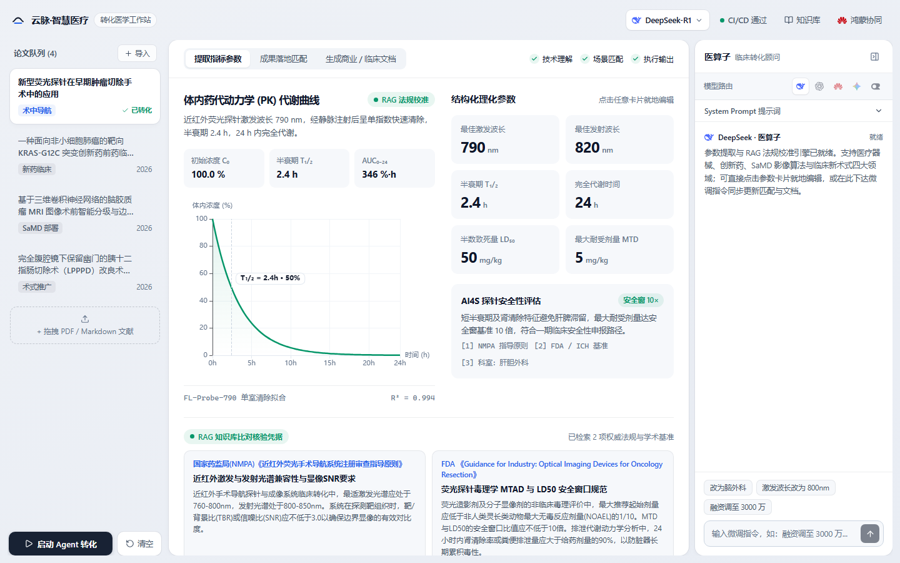
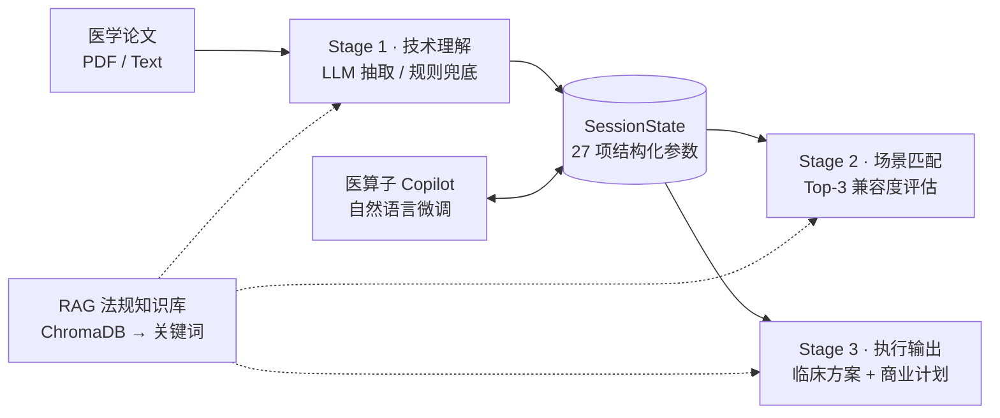
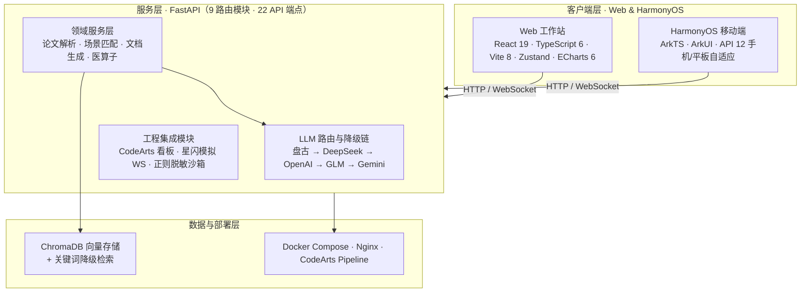
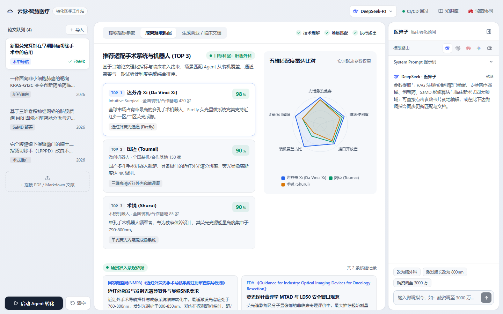
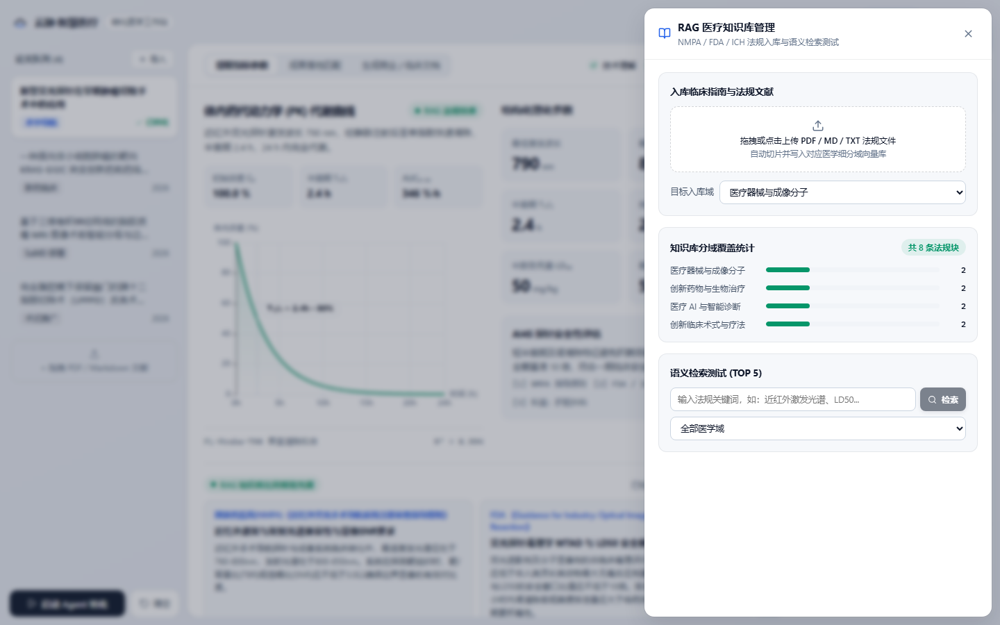

<div align="center">

<h1>云脉 · 智慧医疗（Yunmai Medical）</h1>

<p>
  <strong>面向转化医学全链路的轻量级多智能体工作站</strong><br/>
  <sub>Translational Medicine AI Workstation · Structured 27-Field Pipeline · Web &amp; HarmonyOS</sub>
</p>

<p>
  
  
  
  
</p>

<p>
  <a href="#abstract">摘要</a> &nbsp;·&nbsp;
  <a href="#architecture">方法与架构</a> &nbsp;·&nbsp;
  <a href="#interface">界面概览</a> &nbsp;·&nbsp;
  <a href="#quickstart">复现与运行</a> &nbsp;·&nbsp;
  <a href="#updates">近期更新</a> &nbsp;·&nbsp;
  <a href="#limitations">边界声明</a>
</p>

</div>

---

<a id="abstract"></a>

## 1. 摘要（Abstract）

医学科研成果向临床与产业转化普遍面临「文献参数提取—场景合规匹配—临床与商业方案撰写」链路割裂的问题。**云脉·智慧医疗**提出一种以 **27 项强类型结构化参数（`SessionState`）** 为状态中枢的轻量级多智能体工作站，覆盖**医疗器械、创新药物、医疗 AI、临床术式**四类转化医学场景。

系统采用 **Web 工作站 + HarmonyOS 移动端** 双端结构，内置五模型降级链（盘古 / DeepSeek / OpenAI / GLM / Gemini）、ChromaDB 向量与关键词双模 RAG 检索，以及无 API Key 场景下的本地规则与模板兜底引擎，支持单研究者在低成本环境下完成端到端转化推演。

> **项目背景**："华为云杯" 2026 人工智能 OPC 应用创新大赛 · 智慧医疗方向。移动端详细实现见 [HarmonyOS README](harmony-os/README.md)。

<p align="center">
  
</p>

<p align="center">
  <sub><strong>Figure 1.</strong> 云脉 Web 工作站三栏式主界面（Arc × Craft 视觉体系）：左侧论文队列与主流程触发、中央药代动力学（PK）曲线与结构化参数卡片（支持就地编辑与 NMPA/FDA 法规核验）、右侧可折叠「医算子」上下文感知 Copilot。</sub>
</p>

---

<a id="architecture"></a>

## 2. 核心方法与系统架构（Method & Architecture）

系统不采用通用对话套壳，而是将医学文献解析、成果落地匹配、文档生成与「医算子」多轮调参统一收敛到 **27 字段强类型 `SessionState`** 上：任何参数卡片就地微调或自然语言指令都会写回核心状态，并联动刷新下游匹配排序与文档输出。



<p align="center">
  <sub><strong>Figure 2.</strong> 以 <code>SessionState</code> 为状态中枢的三阶段多智能体流水线及 RAG 法规校准机制。</sub>
</p>

### 2.1 四大转化领域建模

| 转化领域 | 标识 | 核心结构化参数示例 | 典型落地匹配标的 |
|:---|:---|:---|:---|
| **医疗器械** | `devices` | 激发/发射波长、半衰期、成像穿透深度、LD50 / MTD | 荧光手术导航机器人（达芬奇 / 图迈 / 术锐） |
| **创新药物** | `drugs` | 靶点、适应症、剂量限制性毒性（DLT）、PK 指标 | CDMO 工艺外包平台、GCP 临床试验基地 |
| **医疗 AI** | `ai` | 影像模态、AUC / 灵敏度、单帧推理延迟 | 医院 PACS 系统集成、SaMD 注册合规路径 |
| **临床术式** | `surgical` | 解剖部位、核心器械、术者学习曲线、并发症终点 | 区域三甲实训中心、多中心临床研究协作 |

<p align="center">
  <sub><strong>Table 1.</strong> 四类转化医学细分领域的参数建模范围与下游匹配标的。</sub>
</p>

### 2.2 分层工程架构



<p align="center">
  <sub><strong>Figure 3.</strong> 端云协同分层架构。Web 后端采用单体 FastAPI 实现以便本地启动与单人维护，所有外部依赖均提供本地降级路径。</sub>
</p>

---

<a id="interface"></a>

## 3. 界面与交互概览（Interface Walkthrough）

<table>
  <tr>
    <td width="50%" align="center" valign="top">
      <br/>
      <sub><strong>Fig. 4a · 成果落地匹配</strong><br/>输出 Top-3 适配手术机器人/基地、五维兼容度雷达图及对应法规准入依据。</sub>
    </td>
    <td width="50%" align="center" valign="top">
      <br/>
      <sub><strong>Fig. 4b · 临床与商业文档生成</strong><br/>双栏并排输出 Phase I 临床方案草案与商业融资计划书，支持一键复制与 <code>.md</code> 导出。</sub>
    </td>
  </tr>
  <tr>
    <td width="50%" align="center" valign="top">
      <br/>
      <sub><strong>Fig. 4c · RAG 医疗知识库抽屉</strong><br/>支持 NMPA / FDA / ICH 指南拖拽入库、四领域覆盖统计与 Top-5 语义检索测试。</sub>
    </td>
    <td width="50%" align="center" valign="top">
      <br/>
      <sub><strong>Fig. 4d · HarmonyOS 双形态原生适配</strong><br/>ArkUI 原生响应布局：平板端（≥720vp）双栏工作台与手机端单列紧凑视图。</sub>
    </td>
  </tr>
</table>

---

<a id="quickstart"></a>

## 4. 快速复现与运行（Quick Start & Reproducibility）

环境要求：`Python 3.12`、`Node.js 20+`（满足 Vite 8 要求）与 `npm`。无 API Key 时自动进入本地规则引擎与模板兜底模式；界面右上角配置模型 Key 后即可切换在线大模型联调。

```bash
git clone https://github.com/Mamroru77/hw-cloud-opc-demo1.git
cd hw-cloud-opc-demo1/harmony-web

# 终端 1：启动后端（API 文档 → http://127.0.0.1:8000/docs）
python -m venv .venv
source .venv/bin/activate   # Windows: .venv\Scripts\activate
pip install -r backend/requirements.txt
python -m uvicorn backend.main:app --host 127.0.0.1 --port 8000

# 终端 2：启动前端（Web 工作站 → http://localhost:5173）
npm install --include=dev
npm run dev
```

> Windows 亦可直接运行 `harmony-web/start-backend.bat` 与 `start-frontend.bat`。

<details>
<summary><strong>展开查看：Docker 部署、测试校验与仓库目录结构</strong></summary>

#### Docker Compose

```bash
cd harmony-web/docker
docker compose up --build
```

默认映射前端 `http://localhost:3000`、后端 `http://localhost:8000`。当前前端 API 地址指向本机 `127.0.0.1:8000`，远程或生产容器部署前需调整 API 地址与反向代理配置。

#### 测试与静态检查

在 `harmony-web/` 目录下执行：

```bash
python -m pytest backend/tests/ -v   # 27 项后端接口与服务单元测试
npm run lint                         # oxlint 静态检查
npm run build                        # TypeScript / Vite 生产构建
```

#### 仓库目录

```text
hw-cloud-opc-demo1/
├── docs/assets/                # README 界面与多端展示图
├── harmony-web/
│   ├── src/
│   │   ├── components/         # 工作台布局、标签页、抽屉与 ECharts 封装
│   │   ├── styles/             # Arc × Craft 设计令牌（tokens.css）与工作区样式
│   │   ├── utils/              # 图表配置、文档模板、本地对话引擎、模型配置
│   │   ├── stores/             # Zustand 状态管理（model / knowledge / harmony）
│   │   ├── hooks/              # 向量检索、模型路由、WebSocket Hooks
│   │   └── lib/                # API 封装、类型定义、常量、脱敏与模拟工具
│   ├── backend/                # FastAPI 路由、服务、5 模型适配器、27 项测试
│   ├── docker/                 # Docker Compose、Dockerfile 与流水线配置
│   └── docs/                   # 研发文档与 CodeArts 研发日志
└── harmony-os/                 # HarmonyOS NEXT（API 12）原生移动端工程
```

延伸文档：[Web 端说明](harmony-web/README.md) · [HarmonyOS 端说明](harmony-os/README.md) · [CodeArts 研发日志](harmony-web/docs/CodeArts_Agent_DevLog.md)

</details>

---

<a id="updates"></a>

## 5. 近期架构重构（Recent Refactor）

- **前端组件模块化**：将原 3,000+ 行单文件 `App.tsx` 拆分为 `TopHeaderBar`、`LeftPaperRail`、`CenterWorkspace`（`ParamsTab` / `MatchingTab` / `DocsTab`）、`RightCopilotSheet`、`OverlayDrawer` 与 `MobileBottomNav`，纯计算逻辑抽离至 `src/utils/`。
- **视觉令牌与无障碍体系**：建立 `src/styles/tokens.css`（Arc × Craft 令牌、WCAG AA+ 文本对比度、本地系统字体栈与焦点可见性），修复首屏主 CTA 被折叠与移动端无入口问题。
- **抽屉接线与缺陷修复**：统一接入知识库管理、CI/CD 质量看板、鸿蒙协同与 NPU 脱敏抽屉；修复 `CICDStatusPanel` 在 ESM 环境下使用 `require('echarts')` 导致图表空白及流水线自动切 Tab 抢占焦点的问题。

---

<a id="limitations"></a>

## 6. 当前边界与声明（Limitations & Scope）

- **单用户原型定位**：后端采用进程级全局状态，知识待审队列与部分审计记录保存在内存中，尚未支持多租户会话隔离与持久化数据库。
- **模拟能力边界**：设备发现与星闪通道为 WebSocket 模拟实现；「NPU 脱敏」目前基于正则规则处理，并非硬件级 NPU 推理或完整的医疗数据匿名化方案。
- **生产部署加固要求**：当前版本未配置完整鉴权、HTTPS 与严格 CORS 策略，**请勿直接承载真实患者隐私数据**。
- **非临床决策免责**：生成的临床研究方案与商业计划书仅用于科研探讨与成果转化推演，所有剂量、样本量、法规路径与财务假设须由专业人员复核，不得直接用于临床决策或伦理申报。
