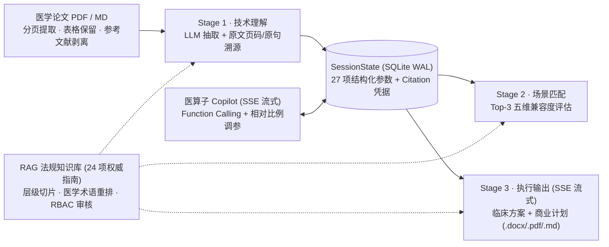
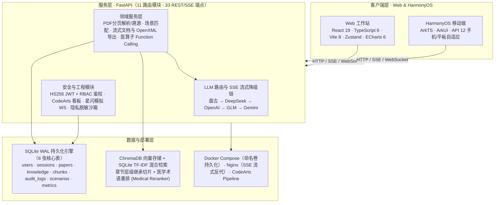
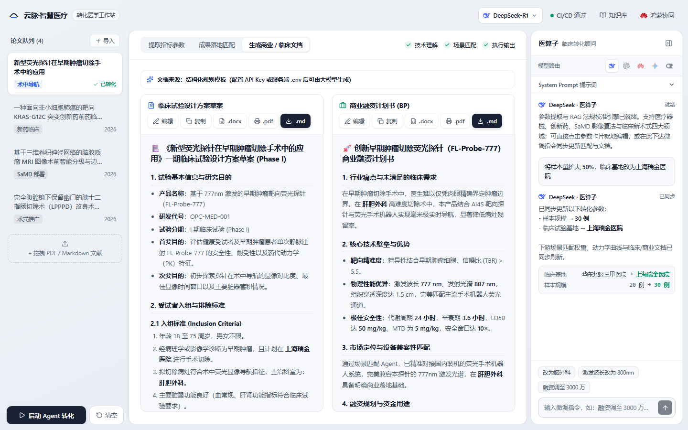
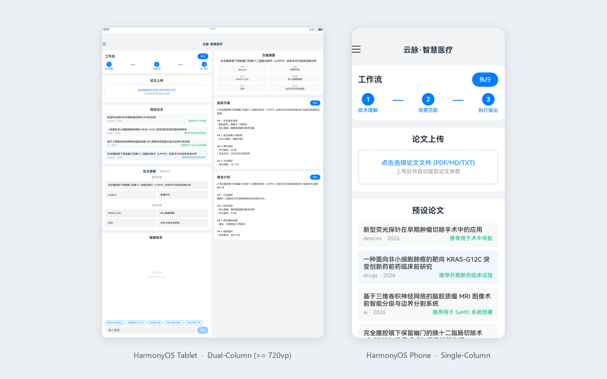

<div align="center">

<h1>云脉 · 智慧医疗（Yunmai Medical）</h1>

<p>
  <strong>面向转化医学全链路的轻量级多智能体工作站</strong><br/>
  <sub>Translational Medicine AI Workstation · Structured 27-Field Pipeline · Web &amp; HarmonyOS</sub>
</p>

<p>
  
  
  
  
  
</p>

<p>
  <a href="#abstract">摘要</a> &nbsp;·&nbsp;
  <a href="#architecture">方法与架构</a> &nbsp;·&nbsp;
  <a href="#interface">界面概览</a> &nbsp;·&nbsp;
  <a href="#quickstart">复现与运行</a> &nbsp;·&nbsp;
  <a href="#updates">P0–P2 产品化演进</a> &nbsp;·&nbsp;
  <a href="#limitations">边界声明</a>
</p>

</div>

---

<a id="abstract"></a>

## 1. 摘要（Abstract）

医学科研成果向临床与产业转化普遍面临「文献参数提取—场景合规匹配—临床与商业方案撰写」链路割裂的问题。**云脉·智慧医疗**提出一种以 **27 项强类型结构化参数（`SessionState`）** 为状态中枢的轻量级多智能体工作站，覆盖**医疗器械、创新药物、医疗 AI、临床术式**四类转化医学场景。

系统采用 **Web 工作站 + HarmonyOS 移动端** 双端结构，内置五模型 SSE 流式降级链（盘古 / DeepSeek / OpenAI / GLM / Gemini）、**24 条权威医疗法规基准库**（NMPA / FDA / ICH / WHO 四领域各 6 条，支持章节层级继承切片与医学术语重排）、**PDF 分页与表格结构化原文溯源（Citation Grounding）**、**SQLite WAL 8 表全链路持久化**、**HS256 JWT + RBAC 知识库双角色审核机制**，以及无 API Key 场景下的高保真本地规则与模板引擎，支持单研究者在低成本环境下完成端到端转化推演并一键导出 `.docx` / `.pdf` / `.md` 申报文档。

> **项目背景**："华为云杯" 2026 人工智能 OPC 应用创新大赛 · 智慧医疗方向。移动端详细实现见 [HarmonyOS README](harmony-os/README.md)。

<p align="center">
  
</p>

<p align="center">
  <sub><strong>Figure 1.</strong> 云脉 Web 工作站三栏式主界面（Arc × Craft 视觉体系）：左侧论文队列与主流程触发、中央药代动力学（PK）曲线与结构化参数卡片（支持就地编辑、<code>P.N 法规校准 / 原文溯源</code> 徽标与高亮证据抽屉）、右侧可折叠「医算子」上下文感知 Copilot（支持 <code>&lt;state_patch&gt;</code> Function Calling、开放词表与相对比例微调）。</sub>
</p>

---

<a id="architecture"></a>

## 2. 核心方法与系统架构（Method & Architecture）

系统不采用通用对话套壳，而是将医学文献解析、成果落地匹配、文档生成与「医算子」多轮调参统一收敛到 **27 字段强类型 `SessionState`** 上：任何参数卡片就地微调或自然语言指令（如「将样本量扩大 50%，临床基地改为上海瑞金医院」）都会通过结构化状态补丁写回核心状态，并实时联动刷新下游匹配排序与双栏文档输出。



<p align="center">
  <sub><strong>Figure 2.</strong> 以 <code>SessionState</code> 为状态中枢的三阶段多智能体流水线、原文溯源及 RAG 法规校准机制。</sub>
</p>

### 2.1 四大转化领域建模

| 转化领域 | 标识 | 核心结构化参数示例 | 典型落地匹配标的 | 法规基准库覆盖 |
|:---|:---|:---|:---|:---|
| **医疗器械** | `devices` | 激发/发射波长、半衰期、成像穿透深度、LD50 / MTD | 荧光手术导航机器人（达芬奇 / 图迈 / 妙手） | NMPA 近红外导则、FDA 光学成像、ISO 10993 等（6 项） |
| **创新药物** | `drugs` | 靶点、适应症、剂量限制性毒性（DLT）、PK 指标 | CDMO 工艺外包平台、GCP 临床试验基地 | ICH S9 抗肿瘤非临床、NMPA FIH 起始剂量、GCP 等（6 项） |
| **医疗 AI** | `ai` | 影像模态、AUC / 灵敏度、单帧推理延迟、接入标准 | 医院 PACS 系统集成、SaMD 三类证注册路径 | NMPA AI 三类审评要点、FDA PCCP、DICOM/HL7 等（6 项） |
| **临床术式** | `surgical` | 解剖部位、核心器械、术者学习曲线、并发症终点 | 区域三甲实训中心、多中心临床研究协作 | 医疗技术临床应用办法、IDEAL 框架、Clavien-Dindo 等（6 项） |

<p align="center">
  <sub><strong>Table 1.</strong> 四类转化医学细分领域的参数建模范围、下游匹配标的与 24 项内置权威法规分布。</sub>
</p>

### 2.2 分层工程架构



<p align="center">
  <sub><strong>Figure 3.</strong> 端云协同分层架构。Web 后端采用自包含 FastAPI + SQLite WAL + ChromaDB/TF-IDF 双擎架构，零外部付费数据库依赖，支持单机一键启动与容器化生产部署。</sub>
</p>

---

<a id="interface"></a>

## 3. 界面与交互概览（Interface Walkthrough）

<table>
  <tr>
    <td width="50%" align="center" valign="top">
      <br/>
      <sub><strong>Fig. 4a · 成果落地匹配</strong><br/>输出 Top-3 适配手术机器人/基地、五维兼容度雷达图及对应 NMPA/FDA 法规准入依据。</sub>
    </td>
    <td width="50%" align="center" valign="top">
      <br/>
      <sub><strong>Fig. 4b · 临床与商业文档生成</strong><br/>双栏 SSE 流式输出临床方案草案与商业融资计划书，支持<strong>在线 Markdown 编辑/预览</strong>及 <code>.docx</code>（标准 OpenXML）/ <code>.pdf</code>（A4 医学排版）/ <code>.md</code> 导出。</sub>
    </td>
  </tr>
  <tr>
    <td width="50%" align="center" valign="top">
      <br/>
      <sub><strong>Fig. 4c · RAG 医疗知识库抽屉（JWT + RBAC）</strong><br/>内置<strong>研究员 / 审评官 (PI) 双角色权限切换</strong>、24 条权威法规四领域均衡覆盖（6×4）与医学术语重排语义检索。</sub>
    </td>
    <td width="50%" align="center" valign="top">
      <br/>
      <sub><strong>Fig. 4d · HarmonyOS 双形态原生适配</strong><br/>ArkUI 原生响应布局：平板端（≥720vp）双栏工作台与手机端单列紧凑视图。</sub>
    </td>
  </tr>
</table>

---

<a id="quickstart"></a>

## 4. 快速复现与运行（Quick Start & Reproducibility）

环境要求：`Python 3.12`、`Node.js 20+`（满足 Vite 8 要求）与 `npm`。无 API Key 时自动进入本地规则引擎与结构化模板兜底模式；界面右上角配置模型 Key（或在服务端 `.env` 中托管密钥）后即可切换在线大模型 SSE 流式联调。

```bash
git clone https://github.com/Mamroru77/hw-cloud-opc-demo1.git
cd hw-cloud-opc-demo1/harmony-web

# 终端 1：启动后端（API 文档 → http://127.0.0.1:8000/docs）
python -m venv .venv
source .venv/bin/activate   # Windows: .venv\Scripts\activate
pip install -r backend/requirements.txt
python -m uvicorn backend.main:app --host 127.0.0.1 --port 8000

# 终端 2：启动前端（Web 工作站 → http://localhost:5173）
npm install --include=dev
npm run dev
```

> Windows 亦可直接运行 `harmony-web/start-backend.bat` 与 `start-frontend.bat`。

<details>
<summary><strong>展开查看：Docker 部署、测试校验与仓库目录结构</strong></summary>

#### Docker Compose 一键容器化部署

```bash
cd harmony-web/docker
docker compose up --build
```

- 默认映射前端 `http://localhost:3000`、后端 `http://localhost:8000`。
- 前端镜像内置 `ARG VITE_API_BASE_URL=/api`，通过 Nginx `/api/` 反向代理（已配置 `proxy_buffering off`、`chunked_transfer_encoding on` 及 WebSocket Upgrade）无缝支持 SSE 流式输出与跨主机部署。
- 内置 `cloudvein-sqlite` 与 `cloudvein-chroma` 命名数据卷，容器重启后自动保留 SQLite WAL 数据库与 ChromaDB 向量索引。

#### 测试与静态检查

在 `harmony-web/` 目录下执行：

```bash
python -m pytest backend/tests/ -v   # 39 项后端接口与服务单元测试（10 个测试模块）
npm run lint                         # oxlint 静态检查（0 warnings, 0 errors）
npx tsc --noEmit                     # TypeScript 6 严格类型检查
npm run build                        # Vite 8 生产构建
```

#### 仓库目录

```text
hw-cloud-opc-demo1/
├── docs/assets/                # README 界面与多端实机展示图
├── harmony-web/
│   ├── src/
│   │   ├── components/         # 工作台布局、标签页（含原文溯源与多格式导出）、抽屉与 ECharts 封装
│   │   ├── styles/             # Arc × Craft 设计令牌（tokens.css）与工作区样式
│   │   ├── utils/              # 图表配置、统一文档模板、.docx/.pdf 导出器、本地对话引擎
│   │   ├── stores/             # Zustand 状态管理（model / knowledge / harmony）
│   │   ├── hooks/              # 向量检索（含 matched_terms 重排）、模型路由、WebSocket Hooks
│   │   └── lib/                # API 封装（含 SSE 流式与 JWT RBAC）、类型定义、常量
│   ├── backend/                # FastAPI 11 路由模块、12 服务模块、SQLite WAL + PDF 溯源解析、39 项测试
│   ├── docker/                 # Docker Compose（含持久化卷）、Dockerfile、Nginx SSE 反代与流水线配置
│   └── docs/                   # 研发文档与 CodeArts 研发日志
└── harmony-os/                 # HarmonyOS NEXT（API 12）原生移动端工程
```

延伸文档：[Web 端说明](harmony-web/README.md) · [HarmonyOS 端说明](harmony-os/README.md) · [CodeArts 研发日志](harmony-web/docs/CodeArts_Agent_DevLog.md)

</details>

---

<a id="updates"></a>

## 5. P0–P2 全链路产品化演进（Product Evolution）

### P0 阶段：架构闭环、容器化与 SSE 流式体验
- **Docker 与 Nginx 生产化对齐**：打通 `VITE_API_BASE_URL` 环境变量与 Vite `/api` 代理；Nginx 增加 SSE 流式反代（`proxy_buffering off`）与 WebSocket 升级支持；Docker Compose 挂载 SQLite 与 ChromaDB 持久化卷。
- **双栏文档与医算子 SSE 流式输出**：新增 `POST /api/generate-docs/stream` 与 `POST /api/chat-agent/stream` 端点，支持五模型降级链首包健康探测与增量流式渲染。
- **前后端 8 套文档模板统一**：全面对齐 4 大领域 × 2 类文档（临床试验方案 / 商业融资计划书）结构与金额精度格式化。

### P1 阶段：医学专业深度（Function Calling、原文溯源与多格式导出）
- **医算子 `<state_patch>` Function Calling 与开放词表调参**：大模型与本地引擎统一支持对全部 27 项 `SessionState` 字段的结构化补丁更新，支持任意开放词表靶点/适应症/临床基地名称提取及相对比例调参（如「样本量扩大 50%」「融资翻倍」「延迟降低 20%」）。
- **PDF 分页/表格解析与参数原文溯源（Citation Grounding）**：基于 `pypdf` 实现带 `[第 N 页]` 锚点与 `[表格数据]` 结构保留的 15,000 字解析窗口，为每项提取参数绑定 `param_citations`（页码、高亮原句、溯源类型），前端参数卡片配备 `P.N 法规校准 / 原文溯源` 徽标与折叠证据抽屉。
- **双栏文档在线编辑与 `.docx` / `.pdf` / `.md` 多格式导出**：新增 `POST /api/docs/export-docx` 纯标准库 ECMA-376 OpenXML `.docx` 生成引擎与前端 A4 医学规范打印视图，支持在线编辑 Markdown 后一键导出 Word、PDF 或 Markdown。

### P2 阶段：数据安全、权威法规扩容与鲁棒性加固
- **SQLite WAL 8 表持久化与 HS256 JWT + RBAC 权限体系**：启用 SQLite WAL 高并发模式，新增 `users` 表与 `/api/auth/token`、`/api/auth/me`、`/api/auth/roles` 接口；知识库实行**临床转化研究员（仅提交待审）**与**医学合规审评官 PI（审批入库/驳回）**双角色 RBAC 强制鉴权与实名审计日志。
- **24 条权威法规库、章节层级切片与医学术语重排**：内置法规由 8 条扩容至 **24 条**（NMPA / FDA / ICH / WHO 四领域各 6 条）；`chunk_text` 支持识别 Markdown 与法规章节标题并自动注入 `[章节: <标题>]` 上下文前缀；检索层新增 `_medical_rerank` 医学专有名词与数值单位加权精排。
- **PDF 参考文献剥离与扫描件自适应降级**：解析前自动剥离文末 `References / 参考文献` 噪区防止历史文献数值污染；自动检测纯图片扫描版 PDF（`is_scanned_pdf`）并平滑引导或降级，避免产生幻觉参数。

---

<a id="limitations"></a>

## 6. 当前边界与声明（Limitations & Scope）

- **轻量自包含架构定位**：系统默认采用 SQLite WAL + ChromaDB/TF-IDF 单机自包含持久化方案，开箱即用、零外部数据库运维成本；若面向大规模多医院 SaaS 集群生产部署，可将持久化层平滑迁移至华为云 RDS for PostgreSQL 并接入企业级 IAM / SSO。
- **模拟能力边界**：设备发现与星闪通道为 WebSocket 模拟实现；「NPU 脱敏」目前基于前后端正则规则沙箱处理，并非硬件级 NPU 推理或完整的 HIPAA 医疗数据匿名化方案。
- **生产部署合规要求**：公网部署前请务必在环境变量中修改自定义 `CLOUDVEIN_JWT_SECRET`、启用 HTTPS 与严格 CORS 白名单，**请勿在未获伦理及数据安全审批前直接承载真实患者隐私数据**。
- **非临床决策免责**：生成的临床研究方案与商业计划书仅用于科研探讨与成果转化推演，所有剂量、样本量、法规路径与财务假设须由专业临床与注册人员复核，不得直接用于临床决策或伦理申报。
